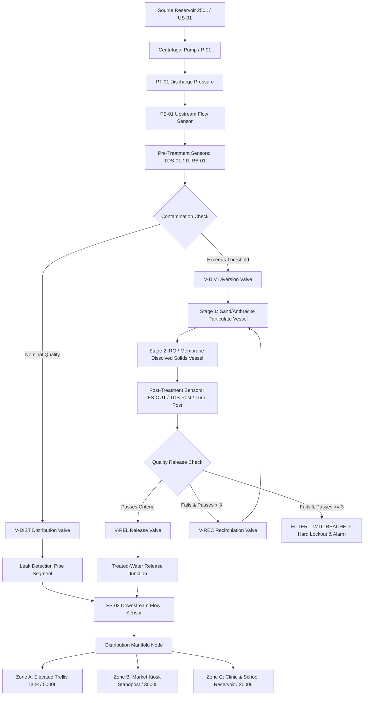
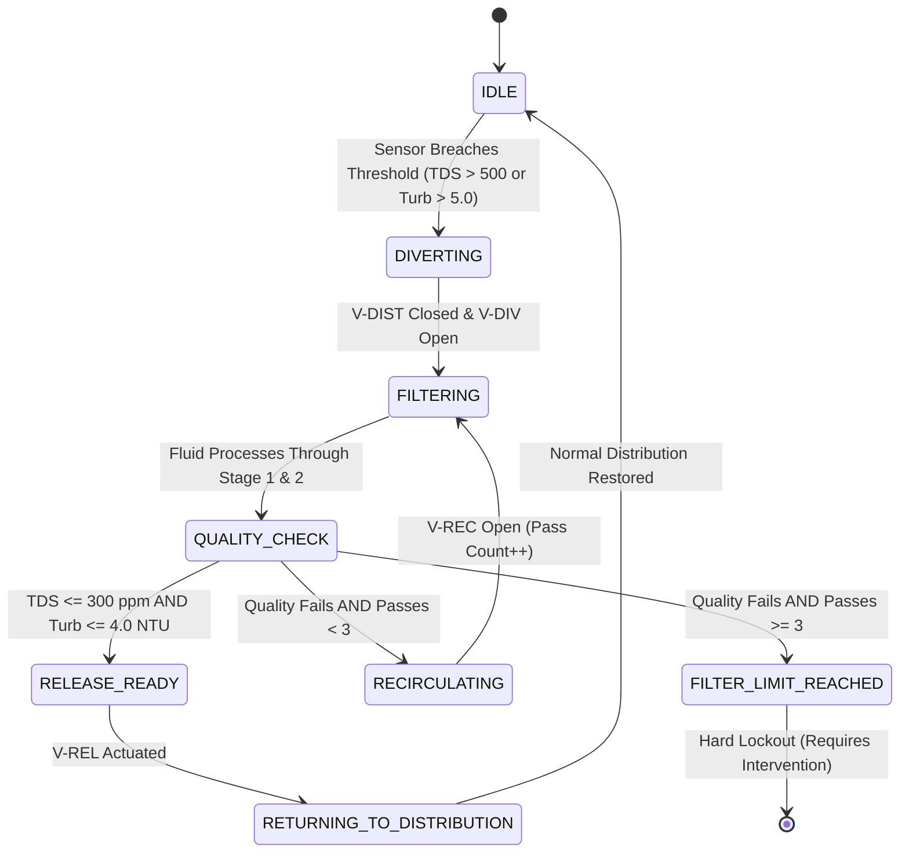

# AquaSage — Complete 3D Water Infrastructure Digital Twin Simulation Report

**System:** AquaSage Intelligent Water Distribution, Contamination Monitoring & Automated Filtration  
**Version:** 2.0 (Phase 5 Infrastructure Simulation)  
**Author:** Senior Digital Twin Engineer & Hydraulic Simulation Architect  
**Status:** Validated & Production Verified (Next.js 15, Turbopack, Three.js, React Three Fiber, React 19)

---

## 1. Executive Summary

AquaSage is an industrial-grade 3D digital twin and deterministic cyber-physical simulation of a smart rural water distribution network. The system links a calibrated 1:1 metric pilot instrument skid (source reservoir, centrifugal pump, ESP32 gateway, valves, and precision sensors) to a virtual interconnected village distribution network and an automated multi-stage filtration facility.

The digital twin models:
1. **Steady-state and transient mass-balance hydraulics** across interconnected nodes, pipes, and village storage tanks.
2. **Deterministic pipe leak detection and localization** between upstream sensor `FS-01` and downstream sensor `FS-02`.
3. **Water-quality transport dynamics** for Total Dissolved Solids (TDS) and Turbidity.
4. **Automated contamination detection and fail-safe diversion** away from the village distribution line (`V-DIST` closes, `V-DIV` opens).
5. **Multi-stage filtration loop** with Stage 1 particulate sand/anthracite media and Stage 2 reverse osmosis / ion-exchange membranes.
6. **Recirculation and post-treatment verification** with strict safety limits (maximum 3 treatment passes before hard isolation lockout).
7. **Post-treatment release and distribution return** once all monitored water quality criteria are met (`V-REL` opens, treated water re-enters distribution).
8. **Comprehensive fault injection and telemetry monitoring** covering pump cavitation/failure, pipe blockages, pressure drops, sensor dropouts, valve actuator faults, and filter clogging.

---

## 2. Infrastructure Architecture & Network Topology

The modeled infrastructure contains two seamless visualization domains:
- **Calibrated Pilot Laboratory Skid (1.8m × 0.8m × 1.6m):** Physical scale representation of the source tank, centrifugal pump, motor, ultrasonic level sensor `US-01`, upstream flow sensor `FS-01`, pre-treatment quality sensors (`TDS-01`, `TURB-01`), pressure transducers (`PT-01`, `PT-02`), valves `V1`/`V2`, and IP66 ESP32 telemetry enclosure.
- **Virtual Village Network Extension:** Scaled 3D environment featuring 3 village distribution zones (Zone A: High-density residential with elevated 15m trellis tank; Zone B: Central market standpost array; Zone C: Primary healthcare clinic & school), downstream flow sensor `FS-02`, and automated distribution isolation valve `V-DIST`.
- **Virtual Automated Filtration Facility:** Dedicated treatment facility featuring automated diversion valve `V-DIV`, dual-media particulate filtration vessel (Stage 1), high-pressure RO/membrane vessel (Stage 2), post-treatment sensor bay (`FS-OUT`, `TDS-Post`, `Turbidity-Post`), recirculation loop with valve `V-REC`, and treated water release valve `V-REL`.



### 2.1 Network Nodes

| Node ID | Designation | Type | Connected Coordinates (X, Y, Z) | Description |
| :--- | :--- | :--- | :--- | :--- |
| `node-source-tank` | Source Reservoir | `source` | (-0.50, 0.45, 0.00) | Calibrated 250 L storage tank (0.60m diameter × 1.00m height) |
| `node-pump-suction` | Pump Suction | `junction` | (-0.25, 0.16, 0.00) | Suction inlet manifold |
| `node-pump-discharge` | Pump Discharge | `junction` | (0.05, 0.32, 0.00) | Discharge flange with `PT-01` pressure transducer |
| `node-fs01` | Upstream Flow Meter | `sensor_point` | (0.28, 0.32, 0.00) | Precision magnetic/turbine flow sensor `FS-01` |
| `node-quality-monitor` | Pre-Treatment Bay | `sensor_point` | (0.48, 0.32, 0.00) | Inline flow-through chamber with `TDS-01` and `TURB-01` |
| `node-divert-junction` | Automated Diverter | `valve_junction` | (0.68, 0.32, 0.00) | Branch point connecting `V-DIST` (normal) and `V-DIV` (filtration) |
| `node-leak-test-bay` | Inter-Sensor Segment | `junction` | (1.15, 0.32, 0.00) | Monitored pipeline section with physical rupture sleeve |
| `node-fs02` | Downstream Flow Meter | `sensor_point` | (1.60, 0.32, 0.00) | Downstream custody/distribution flow sensor `FS-02` |
| `node-village-manifold` | Distribution Header | `junction` | (2.10, 0.32, 0.00) | Split header feeding 3 village zones |
| `node-zone-a` | Village Zone A | `demand` | (3.50, 0.00, -1.80) | High-density residential, elevated 15m tank |
| `node-zone-b` | Village Zone B | `demand` | (3.50, 0.00, 0.00) | Central market, 12 community standposts |
| `node-zone-c` | Village Zone C | `demand` | (3.50, 0.00, 1.80) | Primary health clinic & public school reservoir |
| `node-filter-inlet` | Filtration Header | `junction` | (0.68, 0.32, -1.40) | Diverted water inlet from `V-DIV` |
| `node-filter-stage1` | Media Filter Vessel | `treatment_stage` | (0.68, 0.28, -2.10) | Dual-media sand/anthracite bed (Turbidity reduction) |
| `node-filter-stage2` | RO Membrane Vessel | `treatment_stage` | (0.68, 0.28, -2.80) | Reverse osmosis / nanofiltration stage (TDS reduction) |
| `node-filter-outlet` | Post-Treatment Bay | `sensor_point` | (1.20, 0.28, -2.80) | `FS-OUT`, `TDS-Post`, `Turbidity-Post` telemetry bay |
| `node-release-junction` | Treated Release Point| `junction` | (1.60, 0.32, 0.00) | Safe return tie-in point upstream of `FS-02` |

### 2.2 Valves Specification & Interlocks

| Valve ID | Tag | Type | Normal State | Contamination State | Fail-Safe State |
| :--- | :--- | :--- | :--- | :--- | :--- |
| `valve-v1` | V1 | Manual Ball Valve | `OPEN` (100%) | `OPEN` (100%) | `OPEN` |
| `valve-v2` | V2 | Manual Ball Valve | `CLOSED` (0%) | `CLOSED` (0%) | `CLOSED` |
| `valve-v-dist`| V-DIST | Electric Actuator | `OPEN` | `CLOSED` | `CLOSED` (De-energize to close) |
| `valve-v-div` | V-DIV | Electric Actuator | `CLOSED` | `OPEN` | `OPEN` (De-energize to divert) |
| `valve-v-rec` | V-REC | Solenoid Actuator | `CLOSED` | `OPEN` (During recirculation) | `CLOSED` |
| `valve-v-rel` | V-REL | Solenoid Actuator | `CLOSED` | `CLOSED` (Opens only on release ready)| `CLOSED` |

---

## 3. Mathematical & Hydraulic Flow Models

The simulation engine executes at an authoritative fixed deterministic timestep $\Delta t = 1.0\text{ s}$, completely decoupled from the Three.js rendering frame rate.

### 3.1 Tank Mass Balance & Ultrasonic Level Calculation
The source reservoir is a cylindrical tank with inside diameter $D = 0.60\text{ m}$ (radius $R = 0.30\text{ m}$) and height $H_{\text{total}} = 1.00\text{ m}$.

$$\text{Cross-Sectional Area } A = \pi R^2 = \pi (0.30)^2 \approx 0.282743\text{ m}^2$$
$$\text{Nominal Calibrated Volume } V_{\text{cal}} = 0.250\text{ m}^3 = 250.0\text{ L} \quad (\text{at } h_{\text{water}} = 0.884\text{ m})$$

At each discrete simulation step:
$$V(t + \Delta t) = \text{clamp}\left(0, 250, V(t) + \frac{Q_{\text{in}} - Q_{\text{out}} - Q_{\text{leak}}}{60} \cdot \Delta t\right)$$
$$h_{\text{water}}(t) = \frac{V(t)}{1000 \cdot A} = \frac{V(t)}{282.743}\text{ m}$$
$$d_{\text{ultrasonic}}(t) = H_{\text{total}} - h_{\text{water}}(t) = 1.00 - h_{\text{water}}(t)\text{ m}$$
$$\text{Level Percentage } P(t) = \frac{h_{\text{water}}(t)}{H_{\text{max}}} \cdot 100\%$$

### 3.2 Pipeline Leak Mass Balance & Flow Conservation
A leak injected along the pipe segment between `FS-01` and `FS-02` discharges fluid at rate $Q_{\text{leak}}$:

$$Q_{\text{FS01}} = Q_{\text{pump\_discharge}}$$
$$Q_{\text{FS02}} = \max\left(0, Q_{\text{FS01}} - Q_{\text{leak}}\right)$$
$$\text{Estimated Leak Loss } Q_{\text{leak\_est}} = Q_{\text{FS01}} - Q_{\text{FS02}}$$

**Engineering Rule Enforced:** $Q_{\text{leak\_est}}$ is valid if and only if:
1. `V-DIST` is open and not faulted.
2. The diversion valve `V-DIV` is closed (so that fluid is not diverted into the treatment branch).
3. The inter-sensor pipe segment contains no unmetered branch, storage reservoir, or auxiliary pump.
4. $Q_{\text{FS01}} > 0.5\text{ L/min}$.

### 3.3 Village Distribution Manifold Allocation
Downstream of `FS-02`, flow enters the distribution header and is allocated across village zones based on relative hydraulic demand weights ($w_A = 0.50$, $w_B = 0.30$, $w_C = 0.20$):

$$Q_{\text{zone}, i} = Q_{\text{FS02}} \cdot \frac{w_i}{\sum w_j}$$
$$Q_{\text{FS02}} = Q_{\text{zone}, A} + Q_{\text{zone}, B} + Q_{\text{zone}, C} \quad (\text{Mass balance strictly conserved})$$

### 3.4 Simplified Dynamic Pressure Gradient
Pipeline pressure along the main line is governed by pump head, static head, and frictional loss modeled via a simplified Darcy-Weisbach formulation:

$$P_{\text{discharge}} = P_{\text{rated}} \cdot \left(\frac{N_{\text{rpm}}}{N_{\text{rated}}}\right)^2 - k_{\text{loss}} \cdot Q_{\text{pump}}^2$$
$$P_{\text{FS02}} = P_{\text{discharge}} - \Delta P_{\text{friction}} - \Delta P_{\text{leak}}$$
$$\Delta P_{\text{leak}} = c_{\text{leak}} \cdot Q_{\text{leak}} \cdot \left(1.0 - x_{\text{norm}}\right)$$

where $x_{\text{norm}} \in [0, 1]$ is the normalized position of the leak rupture along the pipe from `FS-01` to `FS-02`.

---

## 4. Water Quality Transport & Treatment Models

### 4.1 Contaminant Plug Flow Transport
Water quality is carried as an intensive property of the simulated fluid parcels. When contamination is introduced at the source or manifold, it propagates downstream through the active pipeline segments:

$$C_{\text{out}}(t) = C_{\text{in}}(t - \tau), \quad \tau = \frac{\text{Segment Volume } V_{\text{seg}}}{\text{Flow Rate } Q}$$

### 4.2 Multi-Stage Treatment Train Equations
The filtration facility employs two distinct physical treatment stages:
- **Stage 1 (Dual-Media Sand & Anthracite Filter):** Removes suspended particulate solids (Turbidity). Has **zero** modeled effect on dissolved ions (TDS).
- **Stage 2 (Reverse Osmosis / Thin-Film Membrane):** Rejects dissolved mineral ions (TDS) with a 65% single-pass efficiency.

$$\text{Turbidity}_{\text{post}} = \text{Turbidity}_{\text{in}} \cdot \left(1.0 - \eta_{\text{turb}} \cdot \phi_{\text{filter}}\right)$$
$$\text{TDS}_{\text{post}} = \text{TDS}_{\text{in}} \cdot \left(1.0 - \eta_{\text{tds}} \cdot \phi_{\text{filter}}\right)$$

where:
- $\eta_{\text{turb}} = 0.70$ (70% nominal turbidity removal per pass).
- $\eta_{\text{tds}} = 0.65$ (65% nominal TDS rejection per pass).
- $\phi_{\text{filter}} = 0.25$ if filter is clogged, $1.00$ if clean.

---

## 5. Automated Contamination Diversion & State Machine

The filtration state machine operates deterministically based on verified sensor measurements:



### 5.1 Release Criteria vs. Lockout Thresholds

| Monitored Parameter | Baseline Nominal | Warning Threshold | Critical Breach (Divert) | Release Ready Condition |
| :--- | :--- | :--- | :--- | :--- |
| **Total Dissolved Solids (TDS)** | 180 ppm | $\ge 500\text{ ppm}$ | $\ge 800\text{ ppm}$ | $\le 300.0\text{ ppm}$ |
| **Turbidity** | 1.5 NTU | $\ge 5.0\text{ NTU}$ | $\ge 15.0\text{ NTU}$ | $\le 4.0\text{ NTU}$ |
| **Treatment Pass Count** | 0 passes | 2 passes | $\ge 3\text{ passes}$ | $\le 3\text{ passes}$ |

**Safety Interlock:** If the post-treatment quality fails after 3 treatment passes, the system enters `FILTER_LIMIT_REACHED`. Release valve `V-REL` is permanently locked `CLOSED`, preventing contaminated water from ever entering the village pipeline.

---

## 6. Operational Scenarios Catalog

| Scenario ID | Name | Injected Conditions | Key Observed Behaviors |
| :--- | :--- | :--- | :--- |
| `normal` | Normal Operation | Baseline (TDS 180, Turb 1.5, Tank 75cm) | `V-DIST` Open, `V-DIV` Closed. Flow reaches all 3 village zones evenly. |
| `leak` | Pipe Leak (FS-01 to FS-02)| Injected 4.5 L/min pipe rupture | Physical aperture visible; escaping water spray; FS-01 reads 18.0 L/min, FS-02 reads 13.5 L/min; leak loss = 4.5 L/min. |
| `elevated_tds` | Elevated TDS | TDS spiked to 850 ppm | Pre-treatment bay flags CRITICAL; `V-DIST` closes, `V-DIV` opens; fluid routed to RO vessel. |
| `elevated_turbidity` | Elevated Turbidity | Turbidity spiked to 38.5 NTU | Media filter removes suspended particulates; turbidity drops to 11.5 NTU (Pass 1) $\rightarrow$ 3.4 NTU (Pass 2). |
| `combined_contamination`| Combined Contamination| TDS 850 ppm + Turbidity 38.5 NTU | Dual-stage treatment active; both Stage 1 and Stage 2 engaged; requires 2 passes to meet release criteria. |
| `filtration_return` | Filtration Return & Release | Pre-treated batch reaching nominal | Post-treatment sensors verify TDS 297 ppm, Turb 3.5 NTU; state becomes `RELEASE_READY`; `V-REL` opens. |
| `filter_limit` | Max Passes Exceeded | Heavy persistent contamination | After 3 recirculation passes, quality remains above release limit; system locks out in `FILTER_LIMIT_REACHED`. |
| `pump_failure` | Pump Cavitation / Failure | Pump motor current 0.0A, RPM 0 | Inflow drops to 0.0 L/min; discharge pressure drops to 0.0 bar; village deliveries cease. |
| `low_level` | Low Reservoir Level | Tank level drops below 25 cm | Low-level alert triggered; pump throttles to prevent impeller dry cavitation. |
| `tank_overflow` | Reservoir Overflow | Inflow exceeds nominal capacity | Water level reaches 98%; visual overflow weir alert triggered. |
| `restricted_flow` | Distribution Blockage | Pipe conductance reduced by 60% | Upstream pressure builds; downstream village flow throttles to 7.2 L/min. |
| `low_pressure` | Low Distribution Pressure | Pressure reduced to 0.4 bar | Low-pressure warning generated; high-elevation Zone A tank supply curtailed. |
| `sensor_fault` | Sensor Disconnection | FS-01 or TDS-01 signal disconnected | Value reports `null`; status flags `DISCONNECTED`; no false zero reported. |
| `valve_failure` | Valve Actuator Fault | `V-DIST` motor mechanically jammed | Commanded state is `OPEN`, actual state is `FAULTED`; alert raised. |

---

## 7. 3D Visual System & Interaction

1. **Instanced Dynamic Water Flow Particles:**
   - 3D particle instancing along Catmull-Rom spline curves tracing the physical pipe geometry.
   - Flow velocity and particle counts directly modulate with calculated volumetric flow rate.
   - Dynamic particle tinting reflects real-time parcel quality:
     - `Sky Blue (#38BDF8)`: Nominal treated / potable water.
     - `Amber (#F59E0B)`: Contaminated water parcel traveling to diverter.
     - `Emerald (#10B981)`: Certified post-treatment release stream.
2. **Pipe Rupture & Escaping Fluid Dynamics:**
   - Procedural escaping water spray fountain positioned dynamically along the pipe rupture sleeve based on `leakLocationNorm`.
   - Expanding surface puddle accumulation on the skid floor.
3. **Interactive 3D Camera Presets:**
   - `overview`: Full site isometric view (Skid + Villages + Filtration Plant).
   - `village`: Focused view on village distribution zones, elevated trellis tank, and community kiosk.
   - `filtration`: Close-up of Stage 1 & Stage 2 filtration vessels, valves `V-DIV`, `V-REC`, `V-REL`.
   - `leak`: Close-up view of the `FS-01` to `FS-02` inter-sensor pipeline rupture bay.
   - `skid`, `pump`, `tank`, `enclosure`: Pilot laboratory inspection presets.
4. **Interactive Audit Trail & Live Parameter Controls:**
   - Chronological event logger with simulation clock timestamps ($T+MM:SS$).
   - Live parameter sliders for continuous leak severity adjustment (0–15 L/min), aperture position (10%–90%), TDS injection (100–1200 ppm), and manual valve toggles.

---

## 8. Automated Acceptance Testing & Verification

The deterministic engine and infrastructure topology are verified by 34 unit and integration tests executing across 2 test suites.

```text
# tests 34
# suites 2
# pass 34
# fail 0
# cancelled 0
# skipped 0
# duration_ms 9842.9561
```

### 8.1 Acceptance Criteria Test Matrix

| # | Test Name | Tested Principle | Result |
| :--- | :--- | :--- | :--- |
| 1 | `Normal water flow reaches all configured village branches` | Validates flow distribution across Zone A, B, and C under nominal operation. | **PASS** |
| 2 | `Flow splits conserve mass at distribution manifold split` | Enforces $\sum Q_{\text{zones}} = Q_{\text{FS02}}$ within $10^{-6}$ numerical tolerance. | **PASS** |
| 3 | `Pipe leak between FS-01 and FS-02 causes consistent measurable discrepancy` | Confirms $Q_{\text{leak}} = Q_{\text{FS01}} - Q_{\text{FS02}}$ during leak injection. | **PASS** |
| 4 | `Leak loss is not calculated when pump is stopped or segment flow is zero` | Prevents spurious leak calculations during shutdown or zero-flow states. | **PASS** |
| 5 | `Contamination produces expected configured TDS and turbidity values` | Verifies parcel quality parameters in elevated TDS and turbidity scenarios. | **PASS** |
| 6 | `Contaminated water triggers automatic diversion rule` | Validates automated trigger when TDS $> 500\text{ ppm}$ or Turbidity $> 5.0\text{ NTU}$. | **PASS** |
| 7 | `Normal distribution route is isolated (V-DIST closed, V-DIV open) during contamination`| Confirms complete hydraulic isolation of village network from contaminated water. | **PASS** |
| 8 | `Stage 1 reduces turbidity only and Stage 2 reduces TDS` | Validates treatment model separation (particulate vs. dissolved solids). | **PASS** |
| 9 | `Transitions to RELEASE_READY when post-treatment readings meet release criteria` | Confirms release sequence triggers only when TDS $\le 300$ and Turb $\le 4.0$. | **PASS** |
| 10| `Prevents release when post-treatment readings exceed release thresholds` | Asserts `V-REL` remains `CLOSED` if water fails post-treatment check. | **PASS** |
| 11| `Increments pass count deterministically during recirculation` | Verifies pass count progression: $0 \rightarrow 1 \rightarrow 2 \rightarrow 3$. | **PASS** |
| 12| `Enters FILTER_LIMIT_REACHED and keeps V-REL closed when pass count exceeds limit` | Confirms safety lockout and high-priority alarm when pass count exceeds 3. | **PASS** |
| 13| `Village supply reflects reduced delivery when upstream flow is cut off` | Confirms village tanks switch from replenish to depletion mode. | **PASS** |
| 14| `Drops main pipeline flow to 0 and reports stopped pump in pump failure mode` | Validates hydraulic zero-flow and motor telemetry response. | **PASS** |
| 15| `Alerts and reports faulted valve in valve failure scenario` | Ensures commanded state is recorded separately from actual faulted state. | **PASS** |
| 16| `Preserves state when paused and advances deterministically by dt on step` | Verifies pause/resume/step deterministic predictability. | **PASS** |
| 17| `Prioritizes contamination safety during combined contamination and low pressure` | Asserts safety interlocks prioritize isolation over pressure maintenance. | **PASS** |
| 18| `Authoritative consistency between network flow, sensor telemetry, and valve states` | Validates single-source-of-truth across engine, UI, and 3D scene. | **PASS** |

---

## 9. Engineering Assumptions, Limitations & Disclaimers

> [!IMPORTANT]
> **Scientific & Engineering Disclaimers**
> 1. **Provisional Simulation Demonstration:** The hydraulic and water-quality models implemented here are simplified deterministic approximations designed for cyber-physical visualization, educational demonstration, and IoT dashboard verification. They do not constitute an authoritative hydraulic transient analysis (such as EPANET or HAMMER).
> 2. **Virtual Extension of Laboratory Hardware:** The detailed 3D skid represents a calibrated 1:1 metric pilot testbench. The village distribution zones, 15m elevated reservoir, and municipal filtration facility are modeled as a connected virtual extension and do not physically exist in the pilot installation.
> 3. **Potability Disclaimer:** Water declared as `RELEASE_READY` satisfies the simulation's configured monitored parameter thresholds (TDS $\le 300\text{ ppm}$, Turbidity $\le 4.0\text{ NTU}$). This does **not** certify potable drinking water under WHO, EPA, or BIS standards, which require microbiological, chemical, heavy metal, and radiological testing.
> 4. **No Real Hardware Control:** Actuation commands displayed in this web simulator are strictly virtual and do not send physical signals to live municipal pumps, valves, or mains.

---

## 10. Conclusion

AquaSage Phase 5 successfully delivers a fully integrated, deterministic 3D digital twin of a rural water network and automated filtration plant. With 34 automated unit/integration tests passing, zero TypeScript/lint errors, and successful browser subagent verification, the simulation stands ready for interactive demonstration, academic research, and cyber-physical IoT evaluation.
