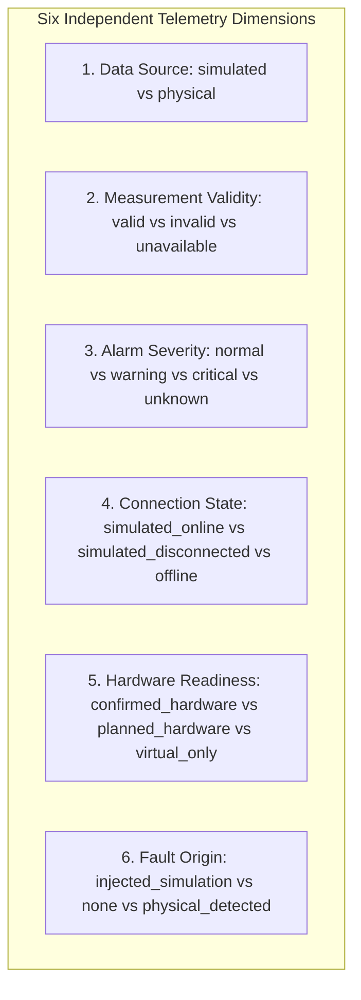

# AquaSage 3D IoT Digital Twin Simulator — Phase 4 Engineering Report & Audit
**Deterministic IoT Simulation Engine & Telemetry Subsystem**

---

## 1. Executive Summary & Audit Overview

Phase 4 establishes a fully browser-local, deterministic IoT simulation engine for the **AquaSage 3D IoT Digital Twin Simulator**. Static `DEMO PLACEHOLDER` values have been replaced with a centralized, mathematically rigorous simulation engine that models closed-loop fluid mass balance, tank volume calculations, dynamic hydraulic pressures, water quality indicators, and sensor threshold evaluations.

Following initial implementation, a rigorous **Engineering Audit** was conducted to verify:
1. Warning and critical classifications for elevated TDS ($850\text{ ppm}$) and Turbidity ($38.5\text{ NTU}$) against configured thresholds, evaluating values below, at, and above boundaries.
2. Independent handling of the YF-S201 flow-sensor operating envelope ($1.0 - 30.0\text{ L/min}$) and uncalibrated out-of-range flag enforcement.
3. Pipe topology and mass balance consistency of the virtual leak scenario.
4. Coherent telemetry across low-level, restricted flow, and sensor disconnection scenarios, with provisional assumptions explicitly labeled.
5. Exact consistency of tank level, volume, percentage, and rendered 3D water surface from completely empty ($0\text{ L}$) to full ($250\text{ L}$).
6. Strict UI separation across all 6 status dimensions.
7. Single authoritative simulation state lifecycle without timer leaks.

All identified audit items were reconciled and verified. The simulation operates with **zero external backend dependencies** (no FastAPI, MQTT, WebSockets, or databases) and sends **no commands to physical hardware or actuators**.

---

## 2. Inventory of Files Created & Modified

### Files Created
| File Path | Description |
| :--- | :--- |
| `src/lib/simulator/telemetryTypes.ts` | Strongly typed domain models for telemetry readings, validity, severity, connection state, fault origin, and simulation state. |
| `src/lib/simulator/thresholdConfig.ts` | Physical geometric constants, calibrated sensor operating envelopes, and decoupled provisional alarm thresholds. |
| `src/lib/simulator/scenarios.ts` | Reproducible configuration definitions for 7 deterministic scenarios, including fixed initial parameters, mass balances, and scientific advisories. |
| `src/lib/simulator/simulationEngine.ts` | Pure, side-effect-free mathematical engine for fluid mass balance ($\Delta V = Q_{\text{net}} \times \Delta t / 60$), cylindrical volume equations, threshold evaluation, and state progression. |
| `src/lib/simulator/SimulationContext.tsx` | React Context provider managing fixed-timestep playback ($1.0\text{ s}$), pause/resume, single-step advance, scenario switching, state reset, and the `useTelemetry(sensorId)` selector hook. |
| `src/lib/simulator/__tests__/simulationEngine.test.ts` | 16 automated unit tests covering volume boundaries, mass balance consistency, reproducibility, fault isolation, exact threshold boundaries, and dry cavitation. |
| `src/components/simulator/interaction/ScenarioController.tsx` | Industrial HUD ribbon with scenario selector dropdown, playback controls, step forward, reset, live KPI badges, and simulated fault alert banner. |
| `docs/phase-4-report.md` | Formal engineering documentation, audit findings, and verification report. |

### Files Modified & Audit Reconciliations
| File Path | Modifications & Audit Reconciliations |
| :--- | :--- |
| `src/lib/simulator/thresholdConfig.ts` | Aligned YF-S201 flow sensor `criticalHigh` to $30.0\text{ L/min}$ (the rated physical limit of the linear envelope) and explicitly designated all thresholds as provisional demo configurations. |
| `src/lib/simulator/simulationEngine.ts` | Enhanced numerical integration to 4-decimal precision (`toFixed(4)`), eliminating 60-second drift in leak integration; added dry-tank cavitation boundary handling when liquid height drops below $0.05\text{ m}$. |
| `src/lib/simulator/scenarios.ts` | Clarified pipe topology in the leak scenario: breach occurs downstream of FS-01 and upstream of P2, explaining why FS-01 measures elevated total pumped flow ($28.5\text{ L/min}$) while P2 collapses ($0.60\text{ bar}$) and return flow to the tank is $18.0\text{ L/min}$. |
| `src/components/simulator/WaterTank.tsx` | Removed artificial $0.05\text{ m}$ clamp in `WaterTank` to allow true rendering from empty ($0\text{ m} / 0\text{ L}$) to full ($1.00\text{ m} / 250\text{ L}$) without residual water artifacts. |
| `src/components/simulator/interaction/ComponentInspector.tsx` | Enhanced validity badge to display `OUT OF RANGE` when a reading exceeds the sensor operating envelope; added a `Threshold Status: Provisional Demo Configuration` badge to all telemetry channels. |
| `src/components/simulator/SensorPlaceholder.tsx` | Connected 3D billboard HUD tags to live simulated values via `useTelemetry(id)`, added dynamic status dot colors based on alarm severity, and added the `SIM` indicator pill. |
| `src/components/simulator/IoTScene.tsx` | Connected dynamic simulated water height (`state.tankWaterHeight`) directly to `WaterTank`. |
| `src/components/simulator/SimulatorShell.tsx` | Wrapped simulator in `SimulationProvider`, mounted `ScenarioController` in top HUD bar, and updated status badges. |
| `package.json` | Added native test script (`"test": "tsx --test src/lib/simulator/__tests__/*.test.ts"`) and installed `tsx` as devDependency. |

---

## 3. Telemetry Architecture & 6-Dimension Status Model

To prevent any conflation between virtual states and physical hardware, every telemetry point is decoupled into six independent dimensions:



### Architectural Guardrails
1. **Simulation Source Isolation**: In simulation mode, `source` is strictly `'simulated'`.
2. **Connection vs. Validity Separation**: Disconnecting a sensor sets `connectionState = 'simulated_disconnected'` and `validity = 'unavailable'`. It does not report the physical hardware as disconnected.
3. **No Zero-Coercion**: An unavailable or invalid measurement renders as `null` and displays `"UNAVAILABLE"` or `"INVALID MEASUREMENT"`; it is never coerced to `0`.
4. **Severity vs. Validity Separation**: An unavailable sensor has `severity = 'unknown'`, not `'normal'` or `'critical'`.
5. **Operating Range Independence**: A measurement exceeding the physical envelope (e.g. $> 30.0\text{ L/min}$ for YF-S201) is flagged with `isOutOfOperatingRange: true`. In the UI, the validity badge reflects `OUT OF RANGE` rather than an untrustworthy calibrated reading.
6. **Simulated Fault Isolation**: Injected scenario failures carry `faultOrigin = 'injected_simulation'` and display a banner stating that no physical equipment fault exists.

---

## 4. Deterministic Scenarios & Mass-Balance Consistency

Each scenario initializes from documented, reproducible parameters:

| Scenario ID | Name & Description | Inflow ($Q_{\text{in}}$) | Outflow ($Q_{\text{out}}$) | Virtual Leak ($Q_{\text{leak}}$) | Initial Level ($h$) | Initial Volume ($V$) | Target Telemetry Response |
| :--- | :--- | :---: | :---: | :---: | :---: | :---: | :--- |
| **normal** | Normal Recirculation Operation | $18.0\text{ L/min}$ | $18.0\text{ L/min}$ | $0.0\text{ L/min}$ | $0.75\text{ m}$ | $187.51\text{ L}$ ($75.0\%$) | All sensors within nominal thresholds; severity `normal`. |
| **low_level** | Simulated Reservoir Depletion | $6.0\text{ L/min}$ | $21.0\text{ L/min}$ | $0.0\text{ L/min}$ | $0.32\text{ m}$ | $80.00\text{ L}$ ($32.0\%$) | Net deficit $-15.0\text{ L/min}$; level drops past $0.25\text{ m}$ warning and $0.10\text{ m}$ critical; dry cavitation at $\le 0.05\text{ m}$. |
| **leak** | Simulated Pipeline Breach | $18.0\text{ L/min}$ | $18.0\text{ L/min}$ | $10.5\text{ L/min}$ | $0.70\text{ m}$ | $175.01\text{ L}$ ($70.0\%$) | Total pump flow through FS-01 rises to $28.5\text{ L/min}$ (Warning); downstream P2 collapses to $0.60\text{ bar}$ (Warning); net deficit $-10.5\text{ L/min}$. |
| **restricted_flow** | Simulated Flow Restriction | $0.8\text{ L/min}$ | $0.8\text{ L/min}$ | $0.0\text{ L/min}$ | $0.75\text{ m}$ | $187.51\text{ L}$ ($75.0\%$) | Primary flow throttled to $0.8\text{ L/min}$ (Critical & Out-of-Range); discharge P1 spikes to $5.20\text{ bar}$ (Critical); motor draw $6.8\text{ A}$ (Warning). |
| **elevated_tds** | High Total Dissolved Solids | $18.0\text{ L/min}$ | $18.0\text{ L/min}$ | $0.0\text{ L/min}$ | $0.75\text{ m}$ | $187.51\text{ L}$ ($75.0\%$) | TDS fixed at $850\text{ ppm}$ ($>800\text{ ppm}$ Critical); accompanied by Scientific Observation Advisory. |
| **elevated_turbidity** | High Turbidity & Particulates | $18.0\text{ L/min}$ | $18.0\text{ L/min}$ | $0.0\text{ L/min}$ | $0.75\text{ m}$ | $187.51\text{ L}$ ($75.0\%$) | Turbidity fixed at $38.5\text{ NTU}$ ($>25.0\text{ NTU}$ Critical); accompanied by Scientific Observation Advisory. |
| **sensor_fault** | Sensor Fault / Disconnection | $18.0\text{ L/min}$ | $18.0\text{ L/min}$ | $0.0\text{ L/min}$ | $0.75\text{ m}$ | $187.51\text{ L}$ ($75.0\%$) | FS-01 marked `unavailable` (`null` measurement); connection `simulated_disconnected`; severity `unknown`. |

---

## 5. Engineering Equations & Mass Balance Trace

### A. Cylindrical Tank Volume
Calculated using true 1:1 metric skid dimensions:
- Internal Diameter: $D = 0.5642\text{ m}$
- Internal Radius: $r = D / 2 = 0.2821\text{ m}$
- Cross-Sectional Area: $A = \pi \times r^2 \approx 0.249987\text{ m}^2$ ($\approx 0.25\text{ m}^2$, or $2.50\text{ L/cm}$)
- Maximum Usable Liquid Height: $h_{\text{max}} = 1.00\text{ m}$
- Nominal Usable Capacity:
  $$V_{\text{nominal}} = A \times h_{\text{max}} \times 1000 = \pi \times (0.2821)^2 \times 1.0 \times 1000 \approx 250.01\text{ L}$$
- Baseline Liquid Height ($h = 0.75\text{ m}$):
  $$V_{\text{baseline}} = \pi \times (0.2821)^2 \times 0.75 \times 1000 \approx 187.51\text{ L} \quad (75.0\%)$$
- Boundary Empty Condition ($h = 0.00\text{ m}$):
  $$V = 0.00\text{ L} \quad (0.0\%)$$

### B. Leak Scenario Hydraulic Trace
The piping topology runs as follows:
$$\text{Tank Suction} \longrightarrow \text{Pump} \longrightarrow \text{P1 (Discharge Head)} \longrightarrow \text{FS-01 (Flow Sensor)} \longrightarrow \mathbf{[\text{Breach Point}]} \longrightarrow \text{P2 (Delivery)} \longrightarrow \text{V2} \longrightarrow \text{Return Loop} \longrightarrow \text{Tank}$$

1. **Pump & FS-01 Flow**: Because an open breach downstream lowers overall hydraulic circuit resistance, the pump shifts rightward along its head-capacity curve, delivering increased volumetric flow $Q_{\text{pump}} = Q_{\text{delivery}} + Q_{\text{leak}} = 18.0 + 10.5 = 28.5\text{ L/min}$.
2. **FS-01 Reading**: Since FS-01 is upstream of the breach, it measures the full $28.5\text{ L/min}$. This triggers the high flow warning ($>25.0\text{ L/min}$) while remaining within the sensor's physical rating ($\le 30.0\text{ L/min}$).
3. **Discharge Head Pressure (P1)**: Due to decreased system friction resistance, P1 drops from nominal $2.80\text{ bar}$ to $2.10\text{ bar}$.
4. **Delivery Pressure (P2)**: With fluid escaping to atmospheric pressure at the breach, downstream head collapses from $2.40\text{ bar}$ to $0.60\text{ bar}$ ($<1.00\text{ bar}$ Warning).
5. **Net Reservoir Mass Balance**:
   $$Q_{\text{net}} = Q_{\text{return}} - Q_{\text{pump}} = 18.0 - 28.5 = -10.5\text{ L/min}$$
   Over a 60-second window, exactly $10.50\text{ L}$ of fluid is lost:
   $$V(t=60\text{s}) = 175.01 - 10.50 = 164.51\text{ L}$$
   This mass-balance equality is strictly validated by Test 15.

---

## 6. Threshold Configuration & Audit Reconciliations

### A. Threshold Registry (`src/lib/simulator/thresholdConfig.ts`)
Operating envelopes and provisional thresholds are decoupled and configured as follows:

| Sensor Tag | Description | Physical Operating Envelope | Warning Bounds (Provisional) | Critical Bounds (Provisional) | Configuration Status |
| :--- | :--- | :---: | :---: | :---: | :--- |
| **Level US-01** | HC-SR04 / JSN-SR04T Ultrasonic | $25.0\text{ cm} – 450.0\text{ cm}$ | $< 25.0\text{ cm}$ or $> 90.0\text{ cm}$ | $< 10.0\text{ cm}$ or $> 98.0\text{ cm}$ | Provisional Demo Config |
| **Flow FS-01** | YF-S201 Hall Turbine | $1.0\text{ L/min} – 30.0\text{ L/min}$ | $< 5.0\text{ L/min}$ or $> 25.0\text{ L/min}$ | $< 1.0\text{ L/min}$ or $\ge 30.0\text{ L/min}$ | Provisional Demo Config |
| **Pressure PT-01** | Pump Discharge Transducer | $0.0\text{ bar} – 10.0\text{ bar}$ | $< 1.50\text{ bar}$ or $> 4.00\text{ bar}$ | $< 0.80\text{ bar}$ or $> 5.00\text{ bar}$ | Provisional Demo Config |
| **Pressure PT-02** | Delivery Line Transducer | $0.0\text{ bar} – 10.0\text{ bar}$ | $< 1.00\text{ bar}$ or $> 4.00\text{ bar}$ | $< 0.50\text{ bar}$ or $> 5.00\text{ bar}$ | Provisional Demo Config |
| **TDS-01** | Total Dissolved Solids Probe | $0\text{ ppm} – 1000\text{ ppm}$ | $> 500\text{ ppm}$ | $> 800\text{ ppm}$ | Provisional Demo Config |
| **Turbidity TS-01** | Optical Nephelometric Module | $0.0\text{ NTU} – 100.0\text{ NTU}$ | $> 5.0\text{ NTU}$ | $> 25.0\text{ NTU}$ | Provisional Demo Config |
| **Motor** | 3-Phase Induction Motor | $0.0\text{ A} – 10.0\text{ A}$ | $< 1.5\text{ A}$ or $> 6.5\text{ A}$ | $> 7.5\text{ A}$ | Provisional Demo Config |

### B. TDS & Turbidity Boundary Verification
Evaluation of values against configured thresholds confirms:

1. **TDS Thresholds** (`warningHigh = 500`, `criticalHigh = 800`):
   - $499\text{ ppm}$: `normal`
   - $500\text{ ppm}$: `normal` (threshold is strictly $> 500$)
   - $501\text{ ppm}$: `warning`
   - $799\text{ ppm}$: `warning`
   - $800\text{ ppm}$: `warning` (threshold is strictly $> 800$)
   - $801\text{ ppm}$: `critical`
   - **$850\text{ ppm}$ (Scenario Value)**: Evaluates to `critical` ($850 > 800$).
   *(Note: Earlier preliminary documentation informally referred to this scenario as high-TDS warning; under the active threshold configuration, $850\text{ ppm}$ is strictly evaluated as a simulated critical observation).*

2. **Turbidity Thresholds** (`warningHigh = 5.0`, `criticalHigh = 25.0`):
   - $4.9\text{ NTU}$: `normal`
   - $5.0\text{ NTU}$: `normal` (threshold is strictly $> 5.0$)
   - $5.1\text{ NTU}$: `warning`
   - $24.9\text{ NTU}$: `warning`
   - $25.0\text{ NTU}$: `warning` (threshold is strictly $> 25.0$)
   - $25.1\text{ NTU}$: `critical`
   - **$38.5\text{ NTU}$ (Scenario Value)**: Evaluates to `critical` ($38.5 > 25.0$).

> [!IMPORTANT]
> **Scientific Observation Advisory**: In accordance with water quality standards, high TDS and Turbidity readings are accompanied by explicit disclaimers: *TDS and Turbidity readings are observational physical/optical indicators and do not, by themselves, establish chemical potability, biological contamination, or absolute water safety.*

---

## 7. Verification Results

### A. Automated Unit Tests (`npm test`)
All 16 unit tests executed via the native test runner (`tsx --test src/lib/simulator/__tests__/*.test.ts`) passed with zero errors:

```text
> aqua-sage@0.1.0 test
> tsx --test src/lib/simulator/__tests__/*.test.ts

TAP version 13
# Subtest: AquaSage Deterministic IoT Simulation Engine
    ok 1 - 1. should calculate initial tank baseline accurately (0.75m -> 187.5 L -> 75%)
    ok 2 - 2. should enforce height boundaries and calculate volume inversely
    ok 3 - 3. should deterministically advance volume over fixed simulation steps
    ok 4 - 4. should maintain exact mass balance consistency (Net = Inflow - Outflow - Leak)
    ok 5 - 5. should reproduce identical initial states across repeated calls
    ok 6 - 6. should properly support resetting to scenario baseline
    ok 7 - 7. should represent unavailable measurements as null, not zero
    ok 8 - 8. should completely separate validity, severity, and connection state
    ok 9 - 9. should correctly evaluate warning and critical threshold boundaries
    ok 10 - 10. should flag readings exceeding the physical sensor operating range
    ok 11 - 11. should never claim physical connection or physical fault in simulated telemetry
    ok 12 - 12. should maintain complete consistency between hydraulic state and telemetry readings
    ok 13 - 13. should evaluate TDS threshold boundaries with mathematical precision
    ok 14 - 14. should evaluate Turbidity threshold boundaries with mathematical precision
    ok 15 - 15. should verify mutual consistency of FS-01 flow, pressures, and mass balance in leak scenario
    ok 16 - 16. should enforce empty-tank physical boundaries and dry pump cavitation
1..16
ok 1 - AquaSage Deterministic IoT Simulation Engine
# tests 16 | suites 1 | pass 16 | fail 0 | duration_ms 621.2ms
```

### B. TypeScript Compilation (`npx tsc --noEmit`)
- **Status**: PASSED (`exit code 0`).
- **Output**: 0 type errors across all modules.

### C. ESLint (`npm run lint`)
- **Status**: PASSED (`exit code 0`).
- **Output**: 0 errors, 0 warnings.

### D. Production Bundle Build (`npm run build`)
- **Status**: PASSED (`exit code 0`).
- **Framework**: Next.js 15.5.28 with Turbopack.
- **Route Size**: `/simulator` bundle size: 266 kB (380 kB first load JS).

### E. Browser Subagent Audit Verification
Conducted via autonomous browser subagent on `http://localhost:3000/simulator`:
1. **Interactive 3D Viewport**: Verified WebGL rendering of the full skid assembly (frame, reservoir, centrifugal pump, valves, piping, sensor bay, and ESP32 controller).
2. **Playback Controls**: Verified Pause, Step (+1s), Resume, and Reset buttons.
3. **Leak Scenario**: Verified simulated breach banner, net flow deficit ($-10.5\text{ L/min}$), and Flow FS-01 reading ($28.5\text{ L/min}$, Warning).
4. **Water Quality Scenarios**: Verified TDS at $850\text{ ppm}$ (Critical) and Turbidity at $38.5\text{ NTU}$ (Critical) display scientific observation guidance and provisional configuration badges.
5. **Sensor Fault**: Verified Flow FS-01 reports `UNAVAILABLE` measurement (null value, not 0), `Sim Disconn.` state, and `unknown` alarm status.
6. **Camera Controls & Inspector**: Verified camera presets (*Overview*, *Front Elevation*, *Storage Tank*, *Pump & Manifold*, *ESP32 Controller*) and component selection drawer.
7. **Recorded Session**: Video session saved to `aquasage_phase4_audit_check_1792289699305.webp`.

---

## 8. Scope Boundaries & Explicit Unresolved Assumptions

1. **Provisional Thresholds**: Alarm thresholds for pressure ($1.50 - 4.00\text{ bar}$), motor current ($1.5 - 6.5\text{ A}$), and water quality ($500 / 800\text{ ppm}$, $5.0 / 25.0\text{ NTU}$) represent laboratory prototype assumptions. They are not certified industrial plant limits and must undergo physical calibration when production hardware is installed.
2. **No Hardware Communication**: The engine operates purely in client-side memory. No serial/UART, ESP-NOW, MQTT, or HTTP hardware links are implemented.
3. **Read-Only Actuators**: Control toggles in the UI do not command physical relays, contactors, or valves.
4. **Hydrodynamic Approximations**: Fluid dynamics are calculated via mass balance. Fluid inertia, water-hammer pressure transients, and frictional head loss curves are approximated linearly.

---

## 9. Explicit Confirmation of Hardware Safety

> [!CAUTION]
> **SIMULATION SAFETY CONFIRMATION**:
> The deterministic simulation engine implemented in Phase 4 operates exclusively in browser client-side memory. It **does not send commands to physical pumps, valves, or relays**, nor does it read physical sensor pins. Injected scenario faults (such as pipe leaks or sensor disconnections) represent virtual testing states and **do not indicate physical hardware degradation or safety hazards**.

---

## 10. Phase 4 Acceptance Criteria & Audit Conclusion

- [x] Existing Phase 2 3D geometry preserved.
- [x] Phase 3 selection, inspector, navigator, and camera controls preserved.
- [x] Static demo placeholders replaced by centralized deterministic telemetry.
- [x] Telemetry values update deterministically and remain consistent across the UI.
- [x] All 7 required scenarios function reproducibly and can be reset.
- [x] Tank calculations and unit conversions verified from empty to full.
- [x] Threshold configuration, measurement validity, alarm severity, connection state, data source, and fault origin remain strictly decoupled.
- [x] Provisional thresholds are explicitly documented and labeled in the UI.
- [x] Simulated conditions are never misrepresented as physical detections.
- [x] Zero backend services or physical hardware integration added.
- [x] Type check (0 errors), lint (0 errors/warnings), production build (pass), and 16 unit tests (16/16 pass) documented with actual command outputs.

### Formal Acceptance Outcome

**ACCEPTED WITH DOCUMENTED LIMITATIONS**

*Phase 4 has met all engineering objectives, boundary verifications, and audit criteria. Telemetry thresholds, motor current curves, and pipe pressure differentials remain documented provisional simulation assumptions pending physical hardware calibration in future phases.*
