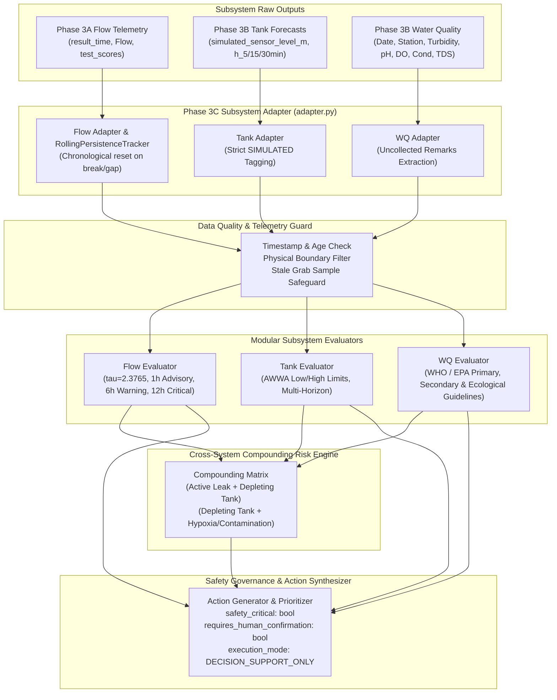

# AquaSage Phase 3C: Unified Decision & Recommendation Engine Report
*(Updated Post-Audit Implementation)*

## 1. Executive Summary

Phase 3C establishes the **AquaSage Unified Decision & Recommendation Engine**, fulfilling the core synthesis layer of the IBM Z Datathon 2026 water management architecture. Following the comprehensive audit documented in `phase3c/PHASE3C_AUDIT_REPORT.md`, all eight approved audit fixes have been fully implemented, verified with regression tests, and integrated:

1. **Safety & Governance Guardrails (SEC-01)**: Mandated `safety_critical: bool`, `requires_human_confirmation: bool`, and `execution_mode: "DECISION_SUPPORT_ONLY"` on every action payload, preventing unintended automated actuator execution in SCADA or Node-RED.
2. **Stale Grab Sample Safeguard (LOG-01)**: Stale water-quality grab samples ($> 14\text{ days}$) are capped at `ADVISORY` severity, returning status `STALE` and generating a `WATER_QUALITY_RESAMPLING` directive rather than an active emergency boil-water notice.
3. **Missing TDS Evaluation (LOG-02)**: Implemented Total Dissolved Solids threshold checks against secondary aesthetic guideline ($500.0\text{ mg/L}$) and critical mineralization limit ($1000.0\text{ mg/L}$), with physical plausibility validation ($0 - 10,000\text{ mg/L}$).
4. **Critical Alkaline pH Condition (LOG-03)**: Added caustic pH condition ($\text{pH} > 9.5$) triggering `CRITICAL` severity and targeted `CHEMICAL_FEED_ADJUSTMENT` directives.
5. **Regulatory Terminology Precision (REG-01)**: Corrected legal phrasing across the engine, rules, and configuration, accurately separating Primary enforceable standards (pathogen-shielding turbidity) from Secondary aesthetic guidelines (pH, TDS) and ecological/stagnation indicators (DO), replacing "regulatory violations" with "guideline exceedances".
6. **Unified Advisory Persistence Rule (CFG-01)**: Reconciled `config.py`, `rules.md`, and `engine.py` onto a single documented, configurable rule: `advisory_hours = 1` ($\tau \ge 2.0$, duration $\ge 1\text{ hour}$).
7. **Subsystem Integration Adapter (INT-01)**: Built `phase3c/adapter.py` providing `RollingPersistenceTracker` (chronological rolling anomaly persistence with instant reset on break or gap) and `SubsystemAdapter` (mapping Phase 3A flow and Phase 3B tank/WQ outputs into Phase 3C schemas without inventing missing data).
8. **Telemetry Status Reachability (SYS-01)**: Restored reachability for `system_status: "DEGRADED_TELEMETRY"` when telemetry is stale, missing, or conflicting without masking under unrelated operational warning labels.

### Deliverables Summary
- **Core Engine & Configuration**: `phase3c/config.py`, `phase3c/engine.py`, `phase3c/__init__.py`
- **Subsystem Adapter & Persistence Tracker**: `phase3c/adapter.py`
- **Formal Rule Book & Standards**: `phase3c/rules.md`
- **Comprehensive Unit & Regression Test Suite**: `phase3c/test_engine.py` (22/22 tests passing, 100% success)
- **Official Example Payloads**: 14 formatted JSON files in `phase3c/examples/` (deterministic decision IDs, full safety governance metadata)
- **Non-Interference Verification**: Zero modifications made to Phase 3A models, Phase 3B scripts, React Native frontend, Node-RED flows, or IBM deployment files.

---

## 2. System Architecture & Information Flow



---

## 3. Subsystem Evaluation Rules & Parameter Standards

### 3.1 Flow Leak Anomaly Detection
- **Calibration Baseline**: In Phase 2 and Phase 3A, the validation split (`val.csv`) calibrated the 99th percentile residual error threshold at $\tau = 2.3765\text{ m}^3/\text{h}$.
- **Volumetric Excess**: $Q_{\text{excess}} = \max(0.0, Q_{\text{actual}} - Q_{\text{pred}})$.
- **Unified Classification Rules**:
  - `CRITICAL`: Persistence $\ge 12\text{ hours}$ OR $Q_{\text{excess}} \ge 15.0\text{ m}^3/\text{h}$ (major distribution main rupture).
  - `WARNING`: Persistence $\ge 6\text{ hours}$ (sustained leak anomaly).
  - `ADVISORY`: Persistence $\ge 1\text{ hour}$ (`advisory_hours = 1`) and Score $\ge 2.0$ (emerging flow deviation).
  - `INFO`: Score $< 2.0$ or persistence $< 1\text{ hour}$ (normal diurnal pattern).
- **Epistemic Constraint**: Anomaly scores reflect statistical deviations from diurnal baselines; they are explicitly presented as anomaly evidence, never as guaranteed leak probabilities.

### 3.2 Hydraulic Reservoir Storage Management
- **Physical Reservoir Dimensions**: $50.0\text{ m}^2$ area, $10.0\text{ m}$ height, $500\text{ m}^3$ storage capacity.
- **Operating Thresholds (AWWA M31 / M42 Guidelines)**:
  - `critical_low_m`: $\le 2.0\text{ m}$ (suction cavitation hazard, loss of fire reserve, distribution de-pressurization).
  - `advisory_low_m`: $\le 3.5\text{ m}$ (storage depletion; schedule pump refill).
  - `advisory_high_m`: $\ge 8.0\text{ m}$ (storage threshold; throttle pump rate).
  - `critical_high_m`: $\ge 9.5\text{ m}$ (structural overflow hazard).
- **Forecasting Integration**: Evaluates $\min(h(t), \hat{h}_{t+5}, \hat{h}_{t+15}, \hat{h}_{t+30})$ and $\max(h(t), \hat{h}_{t+5}, \hat{h}_{t+15}, \hat{h}_{t+30})$.
- **Simulation Disclaimer**: Telemetry is mandatory-tagged with `source_type: SIMULATED_HYDRAULIC_MODEL` and carries the explicit disclaimer: *"Tank levels and forecasts are derived from mass-balance hydraulic simulation, NOT physical level sensors."*

### 3.3 Drinking Water Quality Screening
- **Regulatory Authorities & Legal Distinctions**:
  - **Primary Enforceable Regulations (US EPA NPDWR & WHO Standards)**:
    - *Turbidity*: Standard limit $\le 5.0\text{ NTU}$ (WHO); Critical $\ge 25.0\text{ NTU}$ (massive particulate suspension shielding microbial pathogens from chlorine disinfection).
  - **Secondary Non-Enforceable Aesthetic Guidelines (US EPA NSDWR & WHO Guidelines)**:
    - *pH*: US EPA Secondary standard is $6.5 - 8.5$. Critical acidic is $\le 5.5$ (pipe corrosion/lead leaching); critical alkaline is $\ge 9.5$ (caustic scale/chemical overfeed).
    - *Total Dissolved Solids (TDS)*: US EPA Secondary standard is $\le 500.0\text{ mg/L}$ (palatability and scaling). Critical threshold is $\ge 1000.0\text{ mg/L}$.
  - **Operational Stagnation & Ecological Reference Criteria**:
    - *Dissolved Oxygen (DO)*: US EPA Warmwater Aquatic Life Criterion is $\ge 5.0\text{ mg/L}$. In distribution networks, DO is not a regulated contaminant but an operational proxy for stagnant water and anaerobic decay (critical hypoxia $\le 2.0\text{ mg/L}$).
  - **Screening Indicators**:
    - *Conductivity*: General mineralization proxy ($\le 1000\ \mu\text{S/cm}$ standard screening, $\ge 1500\ \mu\text{S/cm}$ contaminant ingress).
- **Stale Grab Sample Safeguard**: Grab samples older than 14 days do NOT evaluate active emergency directives; they return status `STALE` (severity `ADVISORY`) and trigger `WATER_QUALITY_RESAMPLING`.

---

## 4. Subsystem Adapter Architecture (`adapter.py`)

To bridge Phase 3A/3B outputs to the Decision Engine without hardcoding or manual transformations, `phase3c/adapter.py` provides:

### 4.1 Chronological Rolling Persistence Tracker (`RollingPersistenceTracker`)
- Ingests streaming or batch anomaly scores and timestamps.
- Increments `persistence_hours` sequentially for each consecutive hour where $\text{score} \ge \tau$.
- **Instant Reset**: If score drops below threshold, is missing/NaN, or if a temporal gap ($> 1.5\text{ hours}$) occurs, persistence is immediately reset to 0.

### 4.2 Subsystem Adapter (`SubsystemAdapter`)
- **Phase 3A Flow Mapping**: Maps `result_time`/`timestamp` to `timestamp`, `Flow`/`flow` to `flow_m3h`, `pred`/`predicted_flow` to `predicted_flow_m3h`, and `test_scores`/`anomaly_score` to `anomaly_score`. Computes rolling persistence chronologically.
- **Phase 3B Tank Mapping**: Maps `simulated_sensor_level_m` to `current_level_m`, multi-horizon forecasts (`forecast_5m`, `15m`, `30m`), and automatically tags `source_type: SIMULATED_HYDRAULIC_MODEL` with `is_simulated: True`.
- **Phase 3B Water Quality Mapping**: Maps column headers (`Turbidity (NTU)`, `pH`, `Dissolved Oxygen (mg/L)`, `Conductivity (uS/cm)`, `TDS (mg/L)`). Extracts qualitative remarks (e.g., `"Water level is too low to collect sample"`) without fabricating numbers.

---

## 5. Safety Governance & Decision Support Metadata

In accordance with safety best practices for industrial control systems (ICS/SCADA), the decision engine operates exclusively in a **Decision Support** capacity. Every action dictionary emitted contains explicit machine-readable safety governance fields:

```json
{
  "priority": 1,
  "category": "STORAGE_CONTROL",
  "action": "Override pump station refill rate to maximum (52 m³/h); throttle pressure reducing valves on outflow mains.",
  "rationale": "Tank level projected at 1.82m within 30 min (<= 2.0m limit).",
  "safety_critical": true,
  "requires_human_confirmation": true,
  "execution_mode": "DECISION_SUPPORT_ONLY"
}
```

- `safety_critical: true`: Designates high-consequence interventions (pump overrides, spillway discharges, zone valve isolations, boil-water notices).
- `requires_human_confirmation: true`: Requires explicit licensed operator approval before any physical SCADA or Node-RED actuation.
- `execution_mode: "DECISION_SUPPORT_ONLY"`: Reaffirms that downstream integration layers must never bypass human supervisory authority.

---

## 6. Unit Testing Execution & Actual Results

The complete test suite in `phase3c/test_engine.py` contains 22 unit and regression tests, executed using Python's standard `unittest` runner.

```
======================================================================
Ran 22 tests in 0.004s

OK
======================================================================
```

### Test Case Verification Matrix

| # | Test Class | Test Method Name | Verified Capability | Status |
|---|---|---|---|---|
| 1 | `TestAquaSageDecisionEngine` | `test_scenario_1_normal_conditions` | Nominal operation across all 3 subsystems | **PASS** |
| 2 | `TestAquaSageDecisionEngine` | `test_scenario_2_suspected_leak_levels` | Flow leak tiers (Advisory 2h, Warning 8h, Critical 14h / +23 m³/h) | **PASS** |
| 3 | `TestAquaSageDecisionEngine` | `test_scenario_3_low_and_high_predicted_tank` | Simulated tank depletion ($\le 1.85\text{m}$) & overflow ($\ge 9.7\text{m}$) | **PASS** |
| 4 | `TestAquaSageDecisionEngine` | `test_scenario_4_water_quality_anomalies` | Multiple violations (pH 5.2, turb 28.5 NTU, DO 1.8 mg/L) | **PASS** |
| 5 | `TestAquaSageDecisionEngine` | `test_scenario_5_missing_stale_and_conflicting` | Missing fields, flow age $> 30\text{m}$, negative flow, impossible pH 17.5 | **PASS** |
| 6 | `TestAquaSageDecisionEngine` | `test_scenario_6_simultaneous_compounded_alerts` | Active leak + Depleting tank -> `SYSTEM_CRITICAL_EMERGENCY` | **PASS** |
| 7 | `TestAquaSageDecisionEngine` | `test_scenario_7_uncollected_sample` | Uncollected remark handling without value fabrication | **PASS** |
| 8 | `TestAquaSageDecisionEngine` | `test_compounding_tank_depletion_and_water_quality_hazard` | Low tank level ($2.1\text{m}$) + Hypoxic water ($1.5\text{mg/L}$) | **PASS** |
| 9 | `TestAquaSageDecisionEngine` | `test_historical_batch_source_type_integrity` | Preservation of `HISTORICAL_BATCH` source type | **PASS** |
| 10 | `TestPhase3CAuditFixes` | `test_regression_stale_abnormal_water_quality_does_not_escalate_to_critical` | Stale abnormal grab sample capped at ADVISORY, triggers resampling | **PASS** |
| 11 | `TestPhase3CAuditFixes` | `test_regression_tds_secondary_aesthetic_warning` | TDS $650\text{ mg/L}$ triggers aesthetic exceedance ADVISORY | **PASS** |
| 12 | `TestPhase3CAuditFixes` | `test_regression_tds_critical_threshold` | TDS $1250\text{ mg/L}$ triggers CRITICAL source water management | **PASS** |
| 13 | `TestPhase3CAuditFixes` | `test_regression_tds_plausibility_conflicting` | TDS $15,000\text{ mg/L}$ flagged as CONFLICTING data | **PASS** |
| 14 | `TestPhase3CAuditFixes` | `test_regression_alkaline_caustic_ph_critical` | Alkaline pH $9.85$ triggers CRITICAL chemical feed adjustment | **PASS** |
| 15 | `TestPhase3CAuditFixes` | `test_regression_safety_critical_action_payload_metadata` | Machine-readable safety governance flags verified on all actions | **PASS** |
| 16 | `TestPhase3CAuditFixes` | `test_regression_advisory_persistence_unified_rule` | Unified rule: 0h -> INFO, 1h -> ADVISORY | **PASS** |
| 17 | `TestPhase3CAuditFixes` | `test_regression_deterministic_decision_id` | Deterministic SHA-256 decision ID hashing | **PASS** |
| 18 | `TestSubsystemAdapter` | `test_chronological_rolling_persistence_and_reset` | Sequential increment, instant reset on break and gap (>1.5h) | **PASS** |
| 19 | `TestSubsystemAdapter` | `test_adapt_phase3a_flow_record` | Phase 3A raw flow to Phase 3C schema translation | **PASS** |
| 20 | `TestSubsystemAdapter` | `test_adapt_phase3a_missing_data_does_not_invent` | Missing flow measurements remain None | **PASS** |
| 21 | `TestSubsystemAdapter` | `test_adapt_phase3b_tank_record` | Phase 3B tank level translation with simulated flag | **PASS** |
| 22 | `TestSubsystemAdapter` | `test_adapt_phase3b_water_quality_record_and_remarks` | WQ translation and qualitative remark preservation | **PASS** |

---

## 7. Representative Scenarios & Example Payloads

The 7 operational scenarios were regenerated via `phase3c/generate_examples.py` and saved to `phase3c/examples/`:

1. **`01_normal_conditions`**: All subsystems nominal. System status: `ALL_SYSTEMS_NOMINAL` (`INFO`). Action: routine supervisory monitoring (`safety_critical: false`).
2. **`02_suspected_leak`**: Sustained flow deviation (flow $44\text{ m}^3/\text{h}$, pred $33\text{ m}^3/\text{h}$, score $3.45$, persistence $8\text{ hrs}$). Overall status: `OPERATIONAL_WARNING` (`WARNING`). Action: dispatch acoustic leak detection crew to Area 1 (`safety_critical: true`).
3. **`03_low_tank_level`**: Reservoir storage declining towards $1.82\text{ m}$ within 30 minutes ($< 2.0\text{ m}$ limit). Overall status: `SYSTEM_CRITICAL_EMERGENCY` (`CRITICAL`). Action: override refill pump to maximum ($52\text{ m}^3/\text{h}$) (`safety_critical: true`, `requires_human_confirmation: true`).
4. **`04_water_quality_anomaly`**: Station 4 grab sample reports pH $5.2$, turbidity $28.5\text{ NTU}$, DO $1.8\text{ mg/L}$, conductivity $1600\ \mu\text{S/cm}$. Overall status: `SYSTEM_CRITICAL_EMERGENCY` (`CRITICAL`). Action: issue immediate boil-water drinking advisory and isolate node (`safety_critical: true`, `requires_human_confirmation: true`).
5. **`05_missing_stale_data`**: Stale flow telemetry ($45\text{ min}$ old), missing tank telemetry (`None`), and stale grab sample ($> 14\text{ days}$ old). Overall status: `DEGRADED_TELEMETRY` (`ADVISORY`). Directives: investigate RTU transmission buffers and dispatch technician for fresh grab sample (`WATER_QUALITY_RESAMPLING`).
6. **`06_simultaneous_alerts`**: Active leak in distribution network coinciding with reservoir level dropping to $1.9\text{ m}$. Overall status: `SYSTEM_CRITICAL_EMERGENCY` (`CRITICAL`). Compounding active: Priority 1 directive activates emergency supply protocol to prevent total network de-pressurization.
7. **`07_uncollected_sample`**: Station 7 field sample remark `"Water level is too low to collect sample"`. Overall status: `OPERATIONAL_WARNING` (`WARNING`). Action: inspect well intake depth sensor and suction restriction.

---

## 8. System Limitations, Known Boundaries & Operational Guardrails

1. **Epistemic Gap in Leak Scoring**:
   - The flow anomaly score reflects statistical deviation from diurnal models; legitimate unmetered commercial demand or firefighting usage can elevate scores without physical rupture. Acoustic or correlator confirmation is mandatory prior to excavation.
2. **Synthetic Nature of Hydraulic Tank Forecasting**:
   - Tank levels and forecasts originate from a single-node numerical simulator with Gaussian noise ($\sigma = 0.05\text{ m}$). They are explicitly tagged as simulated and must be connected to physical level sensors in production.
3. **Sparsity of Water Quality Data**:
   - Water quality screening is based on discrete grab samples ($N=29$). They cannot detect transient contaminant slugs between sampling cycles and do not replace continuous inline chlorination monitoring.
4. **Missing Microbiological Telemetry**:
   - Telemetry covers physicochemical indicators only; physicochemical compliance does not certify absolute microbiological potable safety.

---

## 9. Non-Interference Guarantee

The implementation of Phase 3C audit fixes strictly honored all workspace constraints:
- Existing Phase 3A scripts and checkpoints were untouched.
- Existing Phase 3B scripts and models were untouched.
- React Native frontend and Node-RED workflow directories were untouched.
- All code, adapters, rules, configurations, tests, and examples remain self-contained within `phase3c/`.
