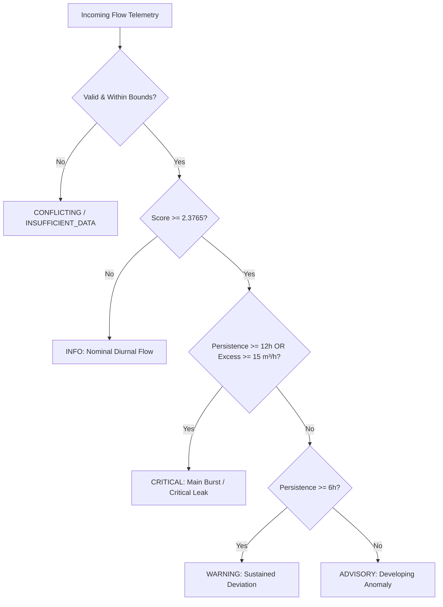

# AquaSage Phase 3C: Unified Decision Engine Rule Book & Operational Standards

## 1. Executive Architecture & Design Principles

The AquaSage Decision Engine (`phase3c/engine.py`) synthesizes telemetry and predictive inferences across three operational dimensions of municipal water distribution:
1. **Flow Leak Anomaly Detection** (Phase 3A LSTM residual detector)
2. **Hydraulic Tank Storage Level Forecasting** (Phase 3B multi-horizon hydraulic AR forecaster)
3. **Physicochemical Drinking Water Quality Assessment** (Phase 3B regulatory screening)

### Core Operational Principles
- **Explainable, Rule-Based Logic**: Zero black-box decision models. Every alert, severity escalation, and operator action traces directly to auditable physical limits, regulatory thresholds, or cross-system compounding risks.
- **Probabilistic vs. Statistical Distinctions**: Model residual scores represent statistical anomaly deviations, never guaranteed leak probabilities.
- **Simulation Transparency**: Simulated hydraulic tank levels are explicitly tagged with `source_type: SIMULATED_HYDRAULIC_MODEL` and accompanied by disclaimers to prevent operators from mistaking mathematical simulations for physical transducers.
- **Data Integrity & Honesty**: Missing, stale, uncollected, or contradictory telemetry triggers explicit data-quality states (`INSUFFICIENT_DATA`, `STALE`, `CONFLICTING`, `UNCOLLECTED_SAMPLE`). Telemetry is never fabricated or imputed silently.
- **Compounding Risk Escalation**: Correlated multi-system failures (e.g., active pipeline burst coinciding with reservoir depletion) escalate to unified emergency directives.

---

## 2. Severity Classification Hierarchy

All subsystem evaluations and overall system states map to a strict 4-tier severity hierarchy:

| Severity Level | Operational Meaning | Action Urgency | System Status Equivalent |
|---|---|---|---|
| `CRITICAL` | Imminent infrastructure rupture, catastrophic de-pressurization, reservoir overflow/cavitation, or acute public health contamination | Immediate (< 15 min) emergency intervention | `SYSTEM_CRITICAL_EMERGENCY` |
| `WARNING` | Sustained flow deviations, progressing storage buffer depletion, multiple water quality exceedances, or uncollected intake restriction | Priority dispatch (< 2 hours) or field inspection | `OPERATIONAL_WARNING` |
| `ADVISORY` | Initial statistical flow deviation, approaching storage thresholds, single parameter aesthetic violation, or stale telemetry | Supervisory logging and next-cycle verification | `ATTENTION_REQUIRED` |
| `INFO` | All observed and forecast parameters operate strictly within normal operating envelopes | Routine supervisory polling | `ALL_SYSTEMS_NOMINAL` |

---

## 3. Subsystem 1: Flow Anomaly & Leak Detection Rules

### Calibration & Thresholds
- **Calibrated Anomaly Threshold ($\tau = 2.3765\text{ m}^3/\text{h}$)**: Derived empirically from the 99th percentile residual error on the Area 1 normal validation split (`data/splits/Area_1/val.csv`).
- **Excess Flow ($Q_{\text{excess}} = \max(0, Q_{\text{actual}} - Q_{\text{predicted}})$)**: Quantifies the physical volumetric leakage rate above normal diurnal expectation.

### Severity Rules

- **CRITICAL**: Persistence $\ge 12\text{ hours}$ OR Volumetric excess flow $Q_{\text{excess}} \ge 15.0\text{ m}^3/\text{h}$.
  - *Directives*: Dispatch acoustic ground-microphone leak crew to sector; isolate DMA zone boundary valve V-102.
- **WARNING**: Persistence $\ge 6\text{ hours}$ (sustained deviation).
  - *Directives*: Schedule field acoustic leak inspection; review minimum night flow (MNF) window.
- **ADVISORY**: Persistence $\ge 1\text{ hour}$ and Score $\ge 2.3765$.
  - *Directives*: Log DMA inlet night-flow over next 03:00–05:00 window to confirm persistence.
- **INFO**: Score $< 2.3765$.
  - *Directives*: Flow patterns conform to normal diurnal curve.

### Anomaly Evidence Note
> "Score represents statistical residual deviation; not guaranteed leak probability. Anomaly scores can be influenced by legitimate unmetered demand spikes, commercial filling, or network configuration shifts."

---

## 4. Subsystem 2: Hydraulic Tank Storage Management Rules

### Structural Reservoir Parameters
- **Cross-Sectional Area**: $50.0\text{ m}^2$
- **Total Physical Height**: $10.0\text{ m}$ (Total Storage Capacity: $500.0\text{ m}^3$)
- **Refill Pump Capacity**: $52.0\text{ m}^3/\text{h}$
- **Simulated Sensor Noise**: $\sigma = 0.05\text{ m}$ Gaussian white noise

### Regulatory & Operating Thresholds (AWWA M31 / M42)
Reservoir operating bands are established according to American Water Works Association (AWWA) guidelines:

| Parameter | Threshold | Operational Hazard | Mitigation Directive |
|---|---|---|---|
| `critical_low_m` | $\le 2.0\text{ m}$ | Suction pump cavitation, loss of municipal fire reserve, network de-pressurization & pipe back-siphonage | Override pump station refill rate to maximum ($52\text{ m}^3/\text{h}$); throttle PRVs on outflow mains |
| `advisory_low_m` | $\le 3.5\text{ m}$ | Storage buffer depletion; insufficient buffer for peak morning demand surge | Schedule pump station activation within 15 min to replenish buffer above $4.5\text{ m}$ |
| `advisory_high_m` | $\ge 8.0\text{ m}$ | High storage level; pump energy wastage and distribution overpressure | Throttle pump refill rate; transition to floating storage mode |
| `critical_high_m` | $\ge 9.5\text{ m}$ | Structural overflow hazard (tank capacity $10.0\text{ m}$) | Throttle/shut down supply pumps immediately; open emergency spillway / bypass valve |

### Multi-Horizon Level Projections
The engine evaluates the current level $h(t)$ along with forecasts at $+5\text{ min}$, $+15\text{ min}$, and $+30\text{ min}$:
$$\min_{\text{projected}} = \min(h(t), \hat{h}_{t+5}, \hat{h}_{t+15}, \hat{h}_{t+30})$$
$$\max_{\text{projected}} = \max(h(t), \hat{h}_{t+5}, \hat{h}_{t+15}, \hat{h}_{t+30})$$

If $\min_{\text{projected}} \le 2.0\text{ m}$, the hazard is classified as `CRITICAL_DEPLETION`.
If $\max_{\text{projected}} \ge 9.5\text{ m}$, the hazard is classified as `CRITICAL_OVERFLOW`.

---

## 5. Subsystem 3: Drinking Water Quality Regulatory Screening Rules

### Regulatory Standard Sources & Legal Classification
To prevent misrepresenting aesthetic or environmental benchmarks as universal potable regulations, thresholds are categorized according to their legal authority:
- **Primary Enforceable Health Standards (US EPA NPDWR & WHO Guidelines)**:
  - *Turbidity*: Limits particulate shielding of pathogenic bacteria against disinfection. EPA NPDWR standard is $\le 1.0\text{ NTU}$ (conventional treatment $\le 0.3\text{ NTU}$); WHO aesthetic and disinfection limit is $\le 5.0\text{ NTU}$. Critical particulate loading is defined at $\ge 25.0\text{ NTU}$.
- **Secondary Non-Enforceable Aesthetic Regulations (US EPA NSDWR & WHO Guidelines)**:
  - *pH*: US EPA Secondary standard is $6.5 - 8.5$ (aesthetic/corrosivity guideline). Critical low is $\le 5.5$ (severe pipe-corrosive acidity); critical high is $\ge 9.5$ (severe caustic scale formation).
  - *Total Dissolved Solids (TDS)*: US EPA Secondary standard is $\le 500.0\text{ mg/L}$ (taste and mineral scaling). Extreme unpalatable threshold is $\ge 1000.0\text{ mg/L}$.
- **Operational Stagnation & Ecological Reference Criteria**:
  - *Dissolved Oxygen (DO)*: US EPA Warmwater Aquatic Life Criterion is $\ge 5.0\text{ mg/L}$. In drinking water distribution networks, DO is not a regulated contaminant but an operational proxy for stagnant water, biofilm proliferation, and anaerobic pipe decay (critical hypoxia $\le 2.0\text{ mg/L}$).
- **Screening Indicators**:
  - *Electrical Conductivity*: General mineralization and saline/industrial ingress proxy ($\le 1000\ \mu\text{S/cm}$ standard potable screening, $\ge 1500\ \mu\text{S/cm}$ contaminant ingress).

### Physicochemical Parameter Bounds

| Parameter | Regulatory Basis | Standard Range | Warning Condition | Critical Condition | Operational Hazard |
|---|---|---|---|---|---|
| **pH** | EPA NSDWR (Secondary) | $6.5 - 8.5$ | $\text{pH} < 6.5$ or $> 8.5$ | $\text{pH} < 5.5$ or $> 9.5$ | Heavy metal pipe leaching (acidic) or caustic scaling (alkaline) |
| **Turbidity** | EPA NPDWR / WHO Primary | $\le 5.0\text{ NTU}$ (WHO) | $> 5.0\text{ NTU}$ | $\ge 25.0\text{ NTU}$ | Particulate shielding of pathogens from chlorine disinfection |
| **Dissolved Oxygen** | EPA Ecological / Operational | $\ge 5.0\text{ mg/L}$ (target) | $< 5.0\text{ mg/L}$ | $\le 2.0\text{ mg/L}$ (Hypoxia) | Anaerobic stagnation, biofilm growth, iron/manganese reduction |
| **Conductivity** | Indicative Screening | $\le 1000\ \mu\text{S/cm}$ | $> 1000\ \mu\text{S/cm}$ | $\ge 1500\ \mu\text{S/cm}$ | Saline or wastewater intrusion into drinking network |
| **TDS** | EPA NSDWR (Secondary) | $\le 500\text{ mg/L}$ | $> 500\text{ mg/L}$ | $\ge 1000\text{ mg/L}$ | Extreme mineral scaling and customer unpalatability |

### Severity Evaluation Logic
- **CRITICAL**: Any critical threshold breached ($\text{pH} < 5.5$ or $> 9.5$, $\text{Turbidity} \ge 25\text{ NTU}$, $\text{DO} \le 2.0\text{ mg/L}$, $\text{Cond} \ge 1500\ \mu\text{S/cm}$, $\text{TDS} \ge 1000\text{ mg/L}$) OR $\ge 3$ simultaneous parameter violations.
  - *Directive*: Issue boil-water / non-potable drinking advisory for sector served by sampling station; isolate node and flush mains.
- **WARNING**: $\ge 2$ simultaneous parameter deviations.
  - *Directive*: Collect confirmatory grab sample within 24 hours; test for coliform bacteria and free chlorine residual.
- **ADVISORY**: Exactly 1 minor parameter deviation.
  - *Directive*: Log deviation; inspect local valve and service connection.
- **INFO**: All parameters within WHO/EPA boundaries.
- **STALE DATA SAFEGUARD**: Grab samples older than 14 days do NOT evaluate active emergency directives; they immediately return status `STALE` (severity `ADVISORY`) and trigger `WATER_QUALITY_RESAMPLING`.

---

## 6. Subsystem 4: Data Quality, Staleness & Physical Validity Standards

To prevent hallucinated inferences or corrupt automated actions, the engine strictly enforces data quality checks:

### 1. Missing Telemetry (`INSUFFICIENT_DATA`)
- Triggered if payload is `None`, missing core parameters (`flow_m3h`, `anomaly_score`, `current_level_m`, or physicochemical parameters), or missing timestamps.
- Action: Directs RTU uplink diagnostic without calculating inferences.

### 2. Stale Telemetry (`STALE`)
- **Flow Telemetry**: Age $> 30\text{ minutes}$ (triggers `COMMUNICATION_WATCH`).
- **Tank Telemetry**: Age $> 15\text{ minutes}$ (triggers `COMMUNICATION_WATCH`).
- **Water Quality Grab Sample**: Age $> 14\text{ days}$ (triggers `WATER_QUALITY_RESAMPLING`).

### 3. Conflicting & Impossible Readings (`CONFLICTING`)
- **Flow**: $Q < 0.0\text{ m}^3/\text{h}$ (backflow meter fault) or $Q > 500.0\text{ m}^3/\text{h}$ (exceeds physical pipe diameter).
- **Tank**: Level $< 0.0\text{ m}$ (negative water) or Level $> 12.0\text{ m}$ (exceeds structural reservoir walls).
- **Water Quality**: $\text{pH} < 0.0$ or $> 14.0$; $\text{DO} < 0.0$ or $> 25.0\text{ mg/L}$; Turbidity $< 0$; Conductivity $< 0$; $\text{TDS} < 0$ or $> 10000\text{ mg/L}$.
- Action: Locks channel and dispatches instrument technician for probe recalibration (`INSTRUMENT_DIAGNOSTIC`).

### 4. Uncollected Field Grab Samples (`UNCOLLECTED_SAMPLE`)
- Triggered when field remark explicitly documents sampling impossibility (e.g. `"Water level is too low to collect sample"`).
- Action: Dispatches intake maintenance crew to inspect well intake depth sensor and suction screen (`INTAKE_INSPECTION`).

---

## 7. Subsystem 5: Multi-System Compounding Risk Escalation

Independent subsystem warnings can compound into severe system emergencies when they interact physically:

### Compound Case A: Active Leak + Depleting Reservoir Storage
- **Trigger**: Flow subsystem reports `leak_suspected = True` AND Tank subsystem reports storage depletion (`hazard_type` in `['CRITICAL_DEPLETION', 'STORAGE_DEPLETION_WARNING']` or $\hat{h}_{t+30} \le 3.5\text{ m}$).
- **Physical Hazard**: A distribution network rupture while reservoir storage is depleting rapidly leads to total distribution de-pressurization, loss of fire protection, and catastrophic back-siphonage of contaminated groundwater through pipe cracks.
- **Escalation**: Escalates overall system to `CRITICAL` / `SYSTEM_CRITICAL_EMERGENCY`.
- **Priority 1 Directive**:
  > *"Activate emergency supply protocol: Override pump station to maximum refill, isolate DMA rupture sector immediately, and alert municipal operations coordinator."*

### Compound Case B: Depleting Reservoir + Hypoxic/Contaminated Water
- **Trigger**: Tank storage is low ($\hat{h}_{t+30} \le 3.5\text{ m}$) AND Water Quality reports `CRITICAL` contamination or severe hypoxia ($\text{DO} \le 2.0\text{ mg/L}$).
- **Physical Hazard**: Drawing from the bottom 2 meters of a stagnant reservoir pulls anaerobic bottom sediment, heavy metals, and biofilm sludge into consumer supply mains.
- **Escalation**: Escalates overall system to `CRITICAL` / `SYSTEM_CRITICAL_EMERGENCY`.
- **Priority 1 Directive**:
  > *"Halt bottom-suction reservoir discharge immediately; transfer distribution supply to auxiliary clearwell bypass."*

---

## 8. Subsystem 6: Action Prioritization & Safety Governance

Operator directives are compiled into a sorted, numbered list based on operational urgency. Every directive payload includes mandatory safety governance metadata:
- `safety_critical: bool` — flags physical actuation (pumps, PRVs, valves, spillways) or public health notices.
- `requires_human_confirmation: bool` — mandates affirmative operator confirmation prior to execution.
- `execution_mode: "DECISION_SUPPORT_ONLY"` — enforces that AquaSage operates strictly as decision support, preventing unauthorized autonomous SCADA actuation.

### Prioritization Hierarchy
1. **Priority 1**: Compounded multi-system operational emergencies (`COMPOUNDED_SYSTEM_EMERGENCY`) — *Safety Critical*
2. **Priority 2**: Instrument diagnostics & sensor recalibration (`INSTRUMENT_DIAGNOSTIC`, `COMMUNICATION_WATCH`, `TELEMETRY_RECOVERY`, `WATER_QUALITY_RESAMPLING`)
3. **Priority 3**: Hydraulic reservoir pump overrides & spillway activations (`STORAGE_CONTROL`) — *Safety Critical*
4. **Priority 4**: Network rupture isolation & acoustic leak detection dispatch (`LEAKAGE_REPAIR` — *Safety Critical*, `LEAKAGE_MONITORING`)
5. **Priority 5**: Public health drinking advisories & grab sampling (`PUBLIC_HEALTH_ADVISORY` — *Safety Critical*, `WATER_QUALITY_INSPECTION`, `INTAKE_INSPECTION`)
6. **Default (Zero Anomalies)**: Standard supervisory SCADA polling (`ROUTINE_MONITORING`)

---

## 9. Subsystem 7: Upstream Telemetry Mapping (`phase3c/adapter.py`)

The `SubsystemAdapter` maps raw and processed outputs from Phase 3A and Phase 3B into Phase 3C schemas:
- **Phase 3A Mapping**: Translates `result_time` $\to$ `timestamp`, `Flow` $\to$ `flow_m3h`, `pred` $\to$ `predicted_flow_m3h`, and `test_scores` $\to$ `anomaly_score`. Automatically tracks chronological rolling persistence and resets it to 0 whenever an anomaly breaks or data is missing.
- **Phase 3B Tank Mapping**: Translates `simulated_sensor_level_m` $\to$ `current_level_m`, preserves simulated inflow/outflow, and enforces `is_simulated = True` with `source_type = SIMULATED_HYDRAULIC_MODEL`.
- **Phase 3B Water Quality Mapping**: Standardizes date formats, isolates uncollected remarks (e.g. from `temperature_c`), and maps physicochemical parameters without data fabrication.

