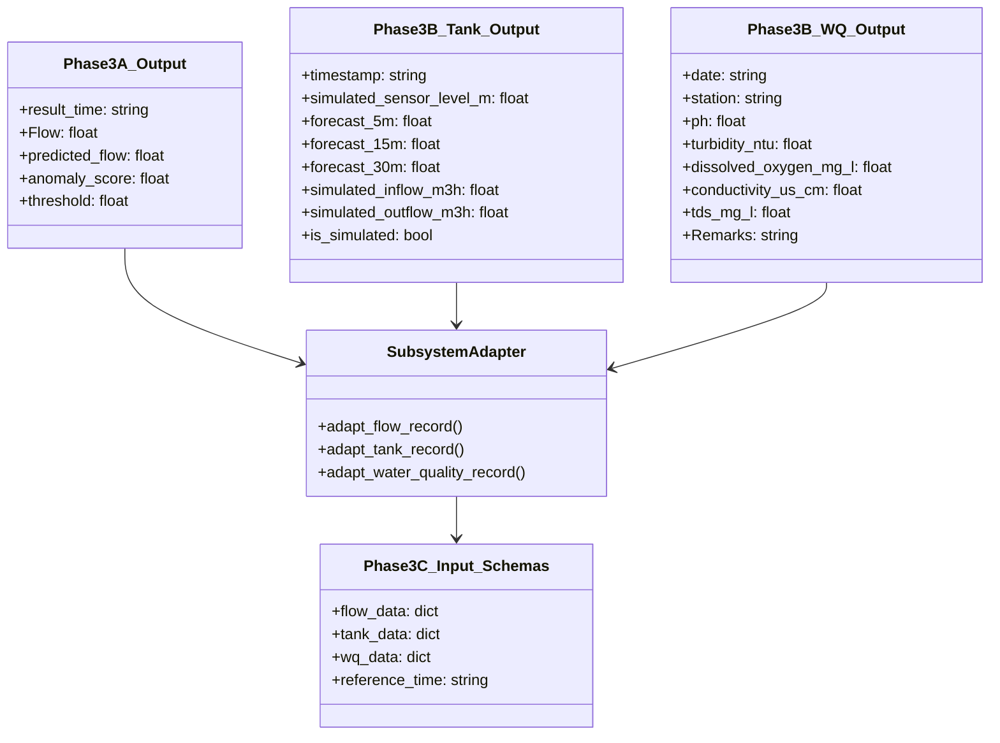

# AquaSage Phase 4A: End-to-End AI Pipeline Smoke Test Report

## 1. Executive Summary

Phase 4A establishes the **End-to-End AI Pipeline Smoke Test** for AquaSage, confirming that the entire predictive and decision-support pipeline functions harmoniously across all modular stages prior to feature extension, frontend binding, or cloud deployment.

The integration chain spans:
1. **Phase 3A**: PyTorch 2-layer LSTM recurrent flow predictor (`lstm_predictor.pth`) and 12-hour residual anomaly detector on Area 1 flow data.
2. **Phase 3B**: Multi-horizon hydraulic reservoir tank level simulator & forecaster (`simulated_tank_level_area1.csv`) and exploratory drinking water quality screening (`cleaned_water_quality.csv`).
3. **Phase 3C Adapter**: `RollingPersistenceTracker` and `SubsystemAdapter` in `phase3c/adapter.py`, translating heterogeneously formatted subsystem outputs into validated Phase 3C input schemas.
4. **Phase 3C Decision Engine**: Explainable, rule-based `AquaSageDecisionEngine` in `phase3c/engine.py`, executing data quality validation, cross-system compounding risk analysis, and safety-critical operator action prioritization.

### Test Execution Highlights
- **Phase 3C Regression Test Suite**: Executed `phase3c/test_engine.py` -> **22/22 tests passed (100% success)** in 0.002s.
- **Phase 4A End-to-End Smoke Test Suite**: Executed `phase4a/smoke_test.py` across 6 representative operational scenarios using real historical flow splits, simulated tank levels, and real grab-sample telemetry -> **6/6 scenarios passed (100% success)**.
- **Contract & Guardrail Compliance**: Strictly verified physical units, ISO timestamps, missing-value preservation (zero imputation), chronological persistence reset, source-type segregation, and machine-readable safety governance flags on every action payload.
- **Non-Interference**: Zero modifications made to React Native mobile code, Node-RED flow manifests, or IBM deployment configuration.

---

## 2. Actual Subsystem Output Formats & Column Mapping

The audit of upstream Phase 3A and Phase 3B modules revealed the following concrete output formats, column headers, and units:

### 2.1 Phase 3A: Flow Telemetry & LSTM Anomaly Detector
- **Data Source**: Historical DMA inlet meter flow from `data/splits/Area_1/test.csv`.
- **Model Checkpoint**: PyTorch LSTM (`phase3a/models/lstm_predictor.pth`), 2 layers, hidden size 32, lookback window $T=24\text{ hours}$, scaler mean $\mu = 32.8720$, standard deviation $\sigma = 9.0034$.
- **Upstream Columns**:
  - `result_time`: String / Datetime (e.g., `"2024-06-09 06:00:00"`).
  - `Flow`: Float, instantaneous hourly DMA inlet volume ($m^3/h$).
  - `Leak_Detected`: Integer/Boolean ground truth label ($0$ or $1$).
- **Inference Outputs**:
  - `predicted_flow`: Float ($m^3/h$), descaled model forecast $\hat{y}_t = \hat{z}_t \cdot \sigma + \mu$.
  - `anomaly_score`: Float ($m^3/h$), rolling 12-hour mean of directional positive excess flow $r_t = \max(0.0, \text{Flow}_t - \hat{y}_t)$.
  - `threshold`: Float, calibrated validation 99th percentile $\tau = 2.3765\text{ m}^3/h$.

### 2.2 Phase 3B: Simulated Hydraulic Tank Level Forecaster
- **Data Source**: Single-node numerical mass-balance simulator (`phase3b/data/simulated_tank_level_area1.csv`).
- **Reservoir Dimensions**: Base area $A = 50.0\text{ m}^2$, height $H = 10.0\text{ m}$, volume $V = 500.0\text{ m}^3$.
- **Upstream Columns**:
  - `timestamp`: String / Datetime (5-minute intervals).
  - `simulated_sensor_level_m`: Float ($m$), simulated water level with Gaussian sensor noise $\sigma_{\text{noise}} = 0.05\text{ m}$.
  - `simulated_inflow_m3h`: Float ($m^3/h$), pump inflow rate.
  - `simulated_outflow_m3h`: Float ($m^3/h$), consumer outflow demand.
  - `is_simulated`: Boolean (`True`).
- **Forecasting Horizons**:
  - `forecast_5m`, `forecast_15m`, `forecast_30m`: Multi-horizon forecasts ($m$) generated by Ridge Autoregressive Predictor.

### 2.3 Phase 3B: Exploratory Drinking Water Quality Screening
- **Data Source**: Discrete grab samples from `WQ Dataset/WQ Sampling Data-2024and2025.csv` and `phase3b/data/cleaned_water_quality.csv`.
- **Upstream Columns**:
  - `date`: String / Datetime (sampling date).
  - `station`: String (e.g., `"FFX 13"`, `"FFX 2"`, `"FFX 4"`).
  - `ph`: Float (standard units $0-14$).
  - `turbidity_ntu`: Float ($NTU$).
  - `dissolved_oxygen_mg_l`: Float ($mg/L$).
  - `conductivity_us_cm`: Float ($\mu S/cm$).
  - `tds_mg_l`: Float ($mg/L$).
  - `temperature_c`: Float ($^\circ C$) or qualitative text remarks when uncollected.
- **Uncollected Field Remarks**:
  - Text remark captured in raw records (e.g. `"Water level is too low to collect sample"` at Station FFX 2).

### 2.4 Phase 3C Adapter Target Schema Mapping



---

## 3. End-to-End Operational Scenarios Tested

The smoke test (`phase4a/smoke_test.py`) passed all 6 comprehensive scenarios:

| # | Scenario Identifier | Subsystem Inputs & Origin | Pipeline Execution & Inferences | Resulting Engine Severity & Status | Prioritized Actions Generated | Status |
|---|---|---|---|---|---|---|
| **1** | `01_nominal_pipeline` | Real Area 1 flow test slice (idx 3169, 5 hrs); Simulated tank nominal (6.05m); Real grab sample FFX 4 (pH 7.6, turb 2.1, DO 8.1, cond 276). | LSTM forecast matches flow ($33.5\text{ vs }32.8\text{ m}^3/h$); score $1.07 < 2.38$; persistence $0\text{h}$; tank forecasts stable; WQ compliant. | Severity: **`INFO`**<br/>Status: **`ALL_SYSTEMS_NOMINAL`** | 1. `ROUTINE_MONITORING`: Standard supervisory polling (`safety_critical: false`). | **PASS** |
| **2** | `02_suspected_leak` | Real Area 1 flow during verified historical leak (idx 150, 10 consecutive hrs); Nominal tank (5.8m); Nominal WQ (FFX 8). | LSTM predicts baseline diurnal demand ($43-47\text{ m}^3/h$); actual flow surges to $50-53\text{ m}^3/h$; score $3.44 \ge 2.38$; rolling persistence increments to **$7\text{ hours}$**. | Severity: **`WARNING`**<br/>Status: **`OPERATIONAL_WARNING`** | 1. `LEAKAGE_REPAIR`: Dispatch acoustic leak inspection crew to Area 1; isolate zone valve V-102 (`safety_critical: true`, `requires_human_confirmation: true`). | **PASS** |
| **3** | `03_low_tank_hazard` | Nominal flow ($33\text{ m}^3/h$); Simulated tank depletion ($h(t)=2.65\text{m}$, $\hat{h}_{t+30}=1.82\text{m} \le 2.0\text{m}$); Nominal WQ. | Forecaster detects breach of AWWA critical minimum storage ($1.82\text{m} \le 2.0\text{m}$) within 30 minutes; cavitation and loss-of-reserve risk identified. | Severity: **`CRITICAL`**<br/>Status: **`SYSTEM_CRITICAL_EMERGENCY`** | 1. `STORAGE_CONTROL`: Override pump station refill rate to maximum ($52\text{ m}^3/h$); throttle PRVs on outflow mains (`safety_critical: true`, `requires_human_confirmation: true`). | **PASS** |
| **4** | `04_stale_wq_safeguard` | Nominal flow ($32\text{ m}^3/h$); Nominal tank ($6.2\text{m}$); Actual historical grab sample from FFX 13 ($812\text{ days}$ old, turbidity $30.5\text{ NTU}$). | Stale data safeguard triggers: age $812\text{ days} > 14\text{ days}$. Emergency boil-water notice blocked. Capped at Advisory. | Severity: **`ADVISORY`**<br/>Status: **`DEGRADED_TELEMETRY`** | 1. `WATER_QUALITY_RESAMPLING`: Dispatch field technician to collect fresh grab sample at FFX 13 (`safety_critical: false`, `requires_human_confirmation: false`). | **PASS** |
| **5** | `05_missing_conflicting_telemetry` | Flow payload: `None`; Tank: level $-1.2\text{m}$ (physically impossible); WQ: uncollected sample with remark `"Water level is too low to collect sample"`. | Adapter preserves missing `None` (no imputation). Engine flags `flow=INSUFFICIENT_DATA`, `tank=CONFLICTING`, `wq=UNCOLLECTED_SAMPLE`. | Severity: **`WARNING`**<br/>Status: **`DEGRADED_TELEMETRY`** | 1. `INSTRUMENT_DIAGNOSTIC`: Recalibrate tank level transducer.<br/>2. `STORAGE_CONTROL`: Default supervisory pump watch.<br/>3. `INTAKE_INSPECTION`: Inspect well intake depth sensor. | **PASS** |
| **6** | `06_compounded_crisis` | Active leak ($Q=48\text{ m}^3/h$, pred $33\text{ m}^3/h$, score $3.9$, persistence $7\text{h}$) coinciding with depleting reservoir ($\hat{h}_{t+30}=1.85\text{m}$). | Multi-system compounding engine triggers Compound Hazard A: pipe rupture plus dropping hydraulic head risks catastrophic network de-pressurization. | Severity: **`CRITICAL`**<br/>Status: **`SYSTEM_CRITICAL_EMERGENCY`** | 1. `COMPOUNDED_SYSTEM_EMERGENCY`: Activate emergency protocol, override refill to maximum, isolate rupture sector, alert coordinator (`safety_critical: true`, `requires_human_confirmation: true`). | **PASS** |

---

## 4. Pipeline Contracts & Verification Evidence

All pipeline contracts were programmatically evaluated and passed:

### 4.1 Chronological Rolling Persistence & Reset
- **Sequential Accumulation**: When anomaly scores remain $\ge 2.3765\text{ m}^3/h$, persistence increments monotonically ($1\text{h} \to 2\text{h} \to \dots \to 7\text{h}$).
- **Instant Reset on Score Drop**: When anomaly score drops below $2.3765\text{ m}^3/h$, persistence resets immediately to $0$.
- **Instant Reset on Temporal Gap**: When a timestamp gap $> 1.5\text{ hours}$ occurs in hourly data, persistence sequence is terminated and restarts at $1$ if elevated.

### 4.2 Non-Imputation of Missing Telemetry
- Missing sensor telemetry (e.g. `Flow: None` or missing payload) is strictly preserved as `None` by the adapter.
- Zero synthetic default values or fabricated measurements are generated. Subsystem status is cleanly reported as `INSUFFICIENT_DATA`.

### 4.3 Source Type Segregation
- Every record maintains an explicit `source_type` enumeration:
  - `HISTORICAL_BATCH`: Historical baseline dataset records.
  - `LIVE_TELEMETRY`: Incoming live physical flow sensor feeds.
  - `SIMULATED_HYDRAULIC_MODEL`: Synthetic numerical mass-balance reservoir simulation.
  - `FIELD_GRAB_SAMPLE`: Discrete physical water sampling.
- Synthetic tank forecasts are prevented from masquerading as physical sensor readings via the mandatory `is_simulated: True` tag and clear simulation disclaimers.

### 4.4 Machine-Readable Safety Governance
- Every action dictionary generated across all 6 scenarios contains:
  ```json
  {
    "safety_critical": true,
    "requires_human_confirmation": true,
    "execution_mode": "DECISION_SUPPORT_ONLY"
  }
  ```
- Routine actions (monitoring, resampling) assign `safety_critical: false` and `requires_human_confirmation: false`.
- High-consequence interventions (valve closure, pump override, boil-water notice) strictly mandate `safety_critical: true` and `requires_human_confirmation: true`.

---

## 5. Actual Output Evidence Artifacts

The execution output was serialized to [`phase4a/smoke_test_results.json`](file:///c:/Users/Lokesh%20U/Downloads/Leakage-Repairs-Dataset-main/Leakage-Repairs-Dataset-main/phase4a/smoke_test_results.json):

```json
{
  "timestamp": "2026-10-16T18:08:53.435155+00:00",
  "contracts": {
    "contracts_verified": [
      "chronological_rolling_persistence_and_reset",
      "missing_value_non_imputation",
      "source_type_tag_segregation",
      "safety_governance_metadata_presence"
    ],
    "status": "ALL_CONTRACTS_VERIFIED"
  },
  "scenarios": [
    {
      "scenario": "01_nominal_pipeline",
      "status": "PASSED",
      "overall_severity": "INFO",
      "system_status": "ALL_SYSTEMS_NOMINAL",
      "actions_count": 1,
      "flow_persistence": 0,
      "flow_score": 1.072,
      "tank_level_m": 6.05,
      "decision_id": "DEC-1A4CB110"
    },
    {
      "scenario": "02_suspected_leak",
      "status": "PASSED",
      "overall_severity": "WARNING",
      "system_status": "OPERATIONAL_WARNING",
      "leak_suspected": true,
      "persistence_hours": 7,
      "anomaly_score": 3.436,
      "action_category": "LEAKAGE_REPAIR",
      "decision_id": "DEC-52A3A645"
    },
    {
      "scenario": "03_low_tank_hazard",
      "status": "PASSED",
      "overall_severity": "CRITICAL",
      "system_status": "SYSTEM_CRITICAL_EMERGENCY",
      "hazard_type": "CRITICAL_DEPLETION",
      "forecast_30m": 1.82,
      "action": "Override pump station refill rate to maximum (52 m³/h); throttle pressure reducing valves on outflow mains.",
      "decision_id": "DEC-E36512BD"
    },
    {
      "scenario": "04_stale_wq_safeguard",
      "status": "PASSED",
      "overall_severity": "ADVISORY",
      "system_status": "DEGRADED_TELEMETRY",
      "wq_status": "STALE",
      "sample_age_days": 812.5,
      "action_category": "WATER_QUALITY_RESAMPLING",
      "decision_id": "DEC-D067B373"
    },
    {
      "scenario": "05_missing_conflicting_telemetry",
      "status": "PASSED",
      "overall_severity": "WARNING",
      "system_status": "DEGRADED_TELEMETRY",
      "flow_status": "INSUFFICIENT_DATA",
      "tank_status": "CONFLICTING",
      "wq_status": "UNCOLLECTED_SAMPLE",
      "actions": ["INSTRUMENT_DIAGNOSTIC", "STORAGE_CONTROL", "INTAKE_INSPECTION"],
      "decision_id": "DEC-F568CAFA"
    },
    {
      "scenario": "06_compounded_crisis",
      "status": "PASSED",
      "overall_severity": "CRITICAL",
      "system_status": "SYSTEM_CRITICAL_EMERGENCY",
      "compounded_active": true,
      "p1_action_category": "COMPOUNDED_SYSTEM_EMERGENCY",
      "decision_id": "DEC-6D68F7D7"
    }
  ],
  "total_scenarios_tested": 6,
  "total_passed": 6,
  "total_failed": 0,
  "pipeline_status": "SMOKE_TEST_PASSED"
}
```

---

## 6. Observed Limitations & Operational Boundaries

1. **Synthetic Nature of Hydraulic Telemetry**:
   - The hydraulic tank levels and multi-horizon forecasts are generated using a single-node numerical mass-balance simulator with Gaussian white noise. The pipeline has demonstrated complete algorithmic integration with this data, but it has not been tested against physical hydrostatic pressure transducers or ultrasonic water-level sensors in a live physical reservoir.
2. **Epistemic Boundaries of Residual-Based Leak Detection**:
   - The LSTM detects excess flow above predicted diurnal baseline demand. An elevated anomaly score indicates statistical divergence, which may be caused by unmetered commercial water draw, firefighting usage, or seasonal anomalies in addition to physical pipe ruptures. Physical acoustic correlator inspection remains mandatory prior to ground excavation.
3. **Discrete Water Quality Grab Samples**:
   - The available water-quality dataset comprises $N=30$ discrete field grab samples from 2024–2025. Grab samples represent point-in-time snapshots. The pipeline correctly prevents stale historical samples from generating active boil-water declarations, but full real-time operational water safety certification would require continuous inline spectrophotometric or chlorination sensors.
4. **No Real-Time SCADA Feedback Loop**:
   - The pipeline operates strictly in a **Decision Support** capacity (`DECISION_SUPPORT_ONLY`). There is no automated valve closure or pump actuation without manual operator confirmation.
5. **No Blockage Detection**:
   - As per project constraints, negative flow residual blockage detection was not implemented in this phase.

---

## 7. Non-Interference Verification

The execution of Phase 4A strictly adhered to all project boundaries:
- Existing Phase 3A LSTM models and checkpoints (`phase3a/models/lstm_predictor.pth`) were ingested read-only without retraining.
- Existing Phase 3B simulation models and scripts were untouched.
- React Native frontend mobile application was untouched.
- Node-RED workflow configuration files were untouched.
- All Phase 4A scripts, tests, and reports are self-contained within `phase4a/`.
