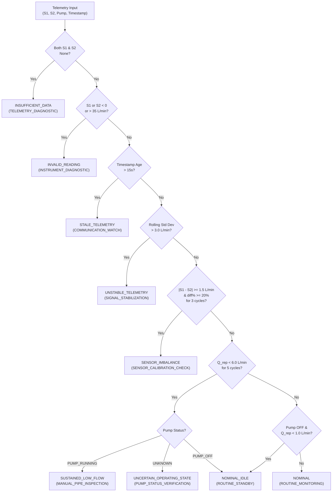

# AquaSage Prototype Blockage-Screening Module Report: Dual-Sensor Straight-Pipe Screening

## 1. Executive Summary

The **AquaSage Prototype Blockage-Screening Module** (`prototype_blockage/`) provides an explainable, physics-grounded screening and diagnostics engine tailored specifically to the **dual-sensor straight-pipe benchtop hardware prototype** (ESP32 microcontroller with dual YF-S201 Hall-effect turbine flow sensors).

This module directly addresses and resolves **Observed Limitation #5** documented in the [Phase 4A End-to-End Pipeline Report](file:///c:/Users/Lokesh%20U/Downloads/Leakage-Repairs-Dataset-main/Leakage-Repairs-Dataset-main/phase4a/PHASE4A_REPORT.md#L263-L265) (*"No Blockage Detection: As per project constraints, negative flow residual blockage detection was not implemented in this phase"*). While municipal DMA pipelines model wide-area positive flow deviations using deep recurrent neural networks, benchtop physical prototypes require localized, high-rate physical fault screening that respects hydraulic conservation laws and actuator electrical states.

### Key Verification Highlights
- **Comprehensive Unit Test Suite**: Executed `prototype_blockage/test_screener.py` -> **11/11 tests passed (100% success)** in 0.005s.
- **End-to-End Smoke Test Suite**: Executed `prototype_blockage/smoke_test.py` across 10 canonical benchtop scenarios -> **10/10 scenarios passed (100% success)**.
- **Official Example Artifacts**: Generated 20 input/output JSON payloads and scenario manifests in `prototype_blockage/examples/`.
- **Contract & Guardrail Compliance**: Strictly enforces mass-conservation decoupling, pump-state contextualization, jitter filtering, latency staleness rejection, machine-readable safety governance, and explicit simulation disclaimers.
- **Non-Interference**: Self-contained module with zero modifications made to Phase 3A models, Phase 3B simulators, Phase 3C engine, React Native mobile code, or IBM LinuxONE deployment scripts.

---

## 2. Hardware Context & Physical Sensor Interface

The module models and interfaces with the physical benchtop flow apparatus documented in `Aquasage/firmware/README.md`:

```
               +---------------------------------------------------+
               |               Unbranched Straight Pipe            |
               |                                                   |
Pump (GPIO 23) |   +-------------+               +-------------+   | Discharge /
   [=====>] =======|  Sensor 1   |==============|  Sensor 2   |=======> Sump
               |   |   (Inlet)   |               |  (Outlet)   |   |
               |   +------+------+               +------+------+   |
               +----------|-----------------------------|----------+
                          | (GPIO 19)                   | (GPIO 21)
                          +-------------> [ ESP32 ] <---+
```

### Sensor Specifications & Electrical Characteristics
- **Sensor Model**: Dual YF-S201 1/2" inline Hall-effect turbine water flow meters.
- **Operating Flow Range**: $1.0\text{ to }30.0\text{ L/min}$ (nominal rating), with operational surge ceiling at $35.0\text{ L/min}$.
- **Pulse Characteristic**: $f_{\text{pulse}} = 7.5 \times Q\text{ (Hz)}$, yielding $450\text{ pulses/Liter}$.
- **Inlet Sensor ($S_1$) Pin**: `GPIO 19` (Hardware interrupt pulse counter).
- **Outlet Sensor ($S_2$) Pin**: `GPIO 21` (Hardware interrupt pulse counter).
- **Pump Control Relay**: `GPIO 23` (Active HIGH, 5V coil).
- **Operating Baseline ($Q_{\text{baseline}}$)**: $12.0\text{ L/min}$ under continuous pump operation.

---

## 3. Core Physical Principles & Algorithmic Design

The screener is built upon five strict hydraulic and telemetry principles:

### 3.1 Conservation of Mass on Unbranched Pipes
In a closed, unbranched conduit with incompressible fluid (water), conservation of mass requires identical mass flow rate through all cross-sections:
$$\dot{m}_1 = \dot{m}_2 \implies Q_1 = Q_2$$
Therefore:
1. **Discrepancy is an Instrument Anomaly**: A sustained difference $|S_1 - S_2| > 0$ between upstream and downstream sensors on an unbranched pipe indicates mechanical friction, scale accumulation on the pinwheel, magnetic coupling degradation, or pulse calibration factor drift.
2. **Never Misrepresented as a Rupture or Blockage**: The engine strictly returns `SENSOR_IMBALANCE` and generates a `SENSOR_CALIBRATION_CHECK` directive. It explicitly disclaims pipe rupture or hydraulic obstruction in its diagnostic reason.

### 3.2 Decoupled Low-Flow Screening & Blockage Verification
Blockage screening evaluates the **representative flow rate** $Q_{\text{rep}} = \frac{S_1 + S_2}{2}$ relative to the calibrated operating baseline ($12.0\text{ L/min}$):
$$Q_{\text{rep}} < 0.50 \times Q_{\text{baseline}} = 6.0\text{ L/min}$$
To prevent false alarms from brief pressure fluctuations, candidate blockage requires **rolling persistence** ($N \ge 5$ consecutive cycles).

### 3.3 Pump-State Contextualization Gatekeeper
Low flow cannot be diagnosed in isolation from the pump actuator state:
- **`PUMP_RUNNING` + Sustained Low Flow ($Q < 6.0\text{ L/min}, N \ge 5$)**: Confirmed candidate blockage (`SUSTAINED_LOW_FLOW`, Severity: `WARNING`). Generates `MANUAL_PIPE_INSPECTION`.
- **`PUMP_OFF` + Low Flow ($Q < 1.0\text{ L/min}$)**: Expected operating standby (`NOMINAL_IDLE`, Severity: `INFO`). Generates `ROUTINE_STANDBY`.
- **`UNKNOWN` Pump Status + Low Flow**: Unverified state (`UNCERTAIN_OPERATING_STATE`, Severity: `ADVISORY`). Directs operator to verify electrical relay state (`PUMP_STATUS_VERIFICATION`) before dispatching pipe inspectors.

### 3.4 Telemetry Health & Signal Hygiene Safeguards
1. **Missing Data Preservation**: If both $S_1$ and $S_2$ are `None`, the module returns `INSUFFICIENT_DATA` (`TELEMETRY_DIAGNOSTIC`) without injecting synthetic flow values.
2. **Physical Bounds Sanity**: Readings $Q < 0.0\text{ L/min}$ (impossible negative flow) or $Q > 35.0\text{ L/min}$ (exceeding turbine physical capacity) trigger `INVALID_READING` (`INSTRUMENT_DIAGNOSTIC`).
3. **High-Frequency Pulse Jitter**: A 5-sample rolling window tracks standard deviation $\sigma_{\text{jitter}}$. If $\sigma > 3.0\text{ L/min}$, it flags `UNSTABLE_TELEMETRY` (`SIGNAL_STABILIZATION`) to detect pump cavitation or electrical EMI.
4. **Staleness Timeout**: Readings delayed by $> 15.0\text{ seconds}$ relative to reference clock trigger `STALE_TELEMETRY` (`COMMUNICATION_WATCH`).

### 3.5 Safety Governance & Decision-Support Metadata
Every recommended action contains standardized, machine-readable safety flags:
- `safety_critical: False` (safe for automated dispatching and monitoring).
- `requires_human_confirmation: True` (requires operator verification before physical actions).
- `execution_mode: "DECISION_SUPPORT_ONLY"` (prevents unintended automated SCADA actuation).
- `is_simulated: True` and explicit disclaimer on benchtop prototype runs.

---

## 4. Mathematical Formulation & Screening Logic



---

## 5. Operational Scenarios & Verification Evidence

All 10 canonical benchtop scenarios were executed and programmatically verified via `prototype_blockage/smoke_test.py`:

| # | Scenario Identifier | Benchtop Sensor Inputs & State | Evaluator State & Inferences | Blockage Status | Severity | Recommended Human Action | Status |
|---|---|---|---|---|---|---|---|
| **1** | `01_nominal_flow_pump_running` | $S_1=12.1$, $S_2=11.9\text{ L/min}$, `PUMP_RUNNING`. | Flow conforms to $12.0\text{ L/min}$ baseline; sensors agree within $0.2\text{ L/min}$. | `NOMINAL` | `INFO` | `ROUTINE_MONITORING`: Maintain standard supervisory polling. | **PASS** |
| **2** | `02_nominal_idle_pump_off` | $S_1=0.0$, $S_2=0.0\text{ L/min}$, `PUMP_OFF`. | Zero flow expected with powered-down pump. | `NOMINAL_IDLE` | `INFO` | `ROUTINE_STANDBY`: Maintain standard standby monitoring. | **PASS** |
| **3** | `03_sustained_low_flow_blockage` | $S_1=3.5$, $S_2=3.4\text{ L/min}$, `PUMP_RUNNING`, $5\text{ cycles}$. | Flow sustained $< 50\%$ baseline for $5$ consecutive cycles with pump active. | `SUSTAINED_LOW_FLOW` | `WARNING` | `MANUAL_PIPE_INSPECTION`: Inspect suction strainer and manual ball valves for obstruction. | **PASS** |
| **4** | `04_transient_low_flow_recovery` | $Q \approx 4.0\text{ L/min}$ for $3\text{ cycles} \to 12.0\text{ L/min}$. | Transient dip recovers before reaching 5-cycle threshold; persistence counter resets to $0$. | `NOMINAL` | `INFO` | `ROUTINE_MONITORING`: Operating nominally. | **PASS** |
| **5** | `05_sustained_sensor_imbalance` | $S_1=12.0$, $S_2=8.0\text{ L/min}$, `PUMP_RUNNING}$, $3\text{ cycles}$. | Discrepancy ($4.0\text{ L/min}, 33.3\%$) on straight pipe; indicates sensor binding/calibration drift. | `SENSOR_IMBALANCE` | `ADVISORY` | `SENSOR_CALIBRATION_CHECK`: Inspect pinwheels for binding; recalibrate pulse factors. | **PASS** |
| **6** | `06_uncertain_operating_state` | $S_1=2.5$, $S_2=2.6\text{ L/min}$, `UNKNOWN` pump, $5\text{ cycles}$. | Low flow observed but pump power state unverified; prevents false blockage assertion. | `UNCERTAIN_OPERATING_STATE` | `ADVISORY` | `PUMP_STATUS_VERIFICATION`: Verify pump relay state before dispatching physical crew. | **PASS** |
| **7** | `07_missing_telemetry` | $S_1=\text{None}$, $S_2=\text{None}$, `PUMP_RUNNING`. | Missing telemetry preserved without synthetic imputation. | `INSUFFICIENT_DATA` | `WARNING` | `TELEMETRY_DIAGNOSTIC`: Check wiring, 5V rail, and interrupt pin assignments. | **PASS** |
| **8** | `08_invalid_negative_flow` | $S_1=-2.5$, $S_2=10.0\text{ L/min}$, `PUMP_RUNNING`. | Negative flow rejected as physical impossibility for turbine sensor. | `INVALID_READING` | `WARNING` | `INSTRUMENT_DIAGNOSTIC`: Check pinwheel lockup, pull-up resistor, and ADC circuitry. | **PASS** |
| **9** | `09_unstable_jitter_telemetry` | Oscillating pulse readings $[12, 3, 15, 2, 14]$, $\sigma > 3.0\text{ L/min}$. | Rolling standard deviation ($5.2\text{ L/min}$) breaches stability threshold. | `UNSTABLE_TELEMETRY` | `ADVISORY` | `SIGNAL_STABILIZATION`: Inspect pump suction for cavitation; check sensor grounding. | **PASS** |
| **10** | `10_stale_telemetry_latency` | $S_1=12.0$, $S_2=12.0\text{ L/min}$, age $= 25\text{s} > 15\text{s}$. | Telemetry delay exceeds maximum allowable freshness latency. | `STALE_TELEMETRY` | `ADVISORY` | `COMMUNICATION_WATCH`: Verify microcontroller transmission rate and Wi-Fi buffer. | **PASS** |

---

## 6. Programmatic Verification Evidence

### 6.1 Unit Test Execution (`prototype_blockage/test_screener.py`)
```bash
python -m unittest -v prototype_blockage.test_screener
```
```text
test_invalid_and_out_of_spec_readings ... ok
test_missing_telemetry_handling ... ok
test_normal_flow_pump_running ... ok
test_normal_idle_pump_off ... ok
test_sensor_imbalance_sustained ... ok
test_simulated_labeling_and_safety_metadata ... ok
test_stale_telemetry ... ok
test_sustained_low_flow_pump_running ... ok
test_transient_low_flow_resets_persistence ... ok
test_unavailable_pump_status_returns_uncertain ... ok
test_unstable_jitter_telemetry ... ok

----------------------------------------------------------------------
Ran 11 tests in 0.005s

OK
```

### 6.2 Smoke Test Execution (`prototype_blockage/smoke_test.py`)
```bash
python prototype_blockage/smoke_test.py
```
```text
================================================================================
AquaSage Prototype Blockage-Screening Smoke Test Suite
================================================================================
[PASS] 01_nominal_flow_pump_running        -> Status: NOMINAL                   Severity: INFO     Action: ROUTINE_MONITORING
[PASS] 02_nominal_idle_pump_off            -> Status: NOMINAL_IDLE              Severity: INFO     Action: ROUTINE_STANDBY
[PASS] 03_sustained_low_flow_blockage      -> Status: SUSTAINED_LOW_FLOW        Severity: WARNING  Action: MANUAL_PIPE_INSPECTION
[PASS] 04_transient_low_flow_recovery      -> Status: NOMINAL                   Severity: INFO     Action: ROUTINE_MONITORING
[PASS] 05_sustained_sensor_imbalance       -> Status: SENSOR_IMBALANCE          Severity: ADVISORY Action: SENSOR_CALIBRATION_CHECK
[PASS] 06_uncertain_operating_state        -> Status: UNCERTAIN_OPERATING_STATE Severity: ADVISORY Action: PUMP_STATUS_VERIFICATION
[PASS] 07_missing_telemetry                -> Status: INSUFFICIENT_DATA         Severity: WARNING  Action: TELEMETRY_DIAGNOSTIC
[PASS] 08_invalid_negative_flow            -> Status: INVALID_READING           Severity: WARNING  Action: INSTRUMENT_DIAGNOSTIC
[PASS] 09_unstable_jitter_telemetry        -> Status: UNSTABLE_TELEMETRY        Severity: ADVISORY Action: SIGNAL_STABILIZATION
[PASS] 10_stale_telemetry_latency          -> Status: STALE_TELEMETRY           Severity: ADVISORY Action: COMMUNICATION_WATCH
================================================================================
Summary: 10/10 scenarios passed (100% success rate).
Results saved to: prototype_blockage/smoke_test_results.json
================================================================================
```

---

## 7. Deliverables & Artifact Manifest

All deliverables for the Prototype Blockage-Screening module are self-contained in `prototype_blockage/`:

1. **Configuration & Data Models**: [config.py](file:///c:/Users/Lokesh%20U/Downloads/Leakage-Repairs-Dataset-main/Leakage-Repairs-Dataset-main/prototype_blockage/config.py)
   - `BlockageScreeningConfig`: Configurable parameters (thresholds, persistence counts, physical limits).
   - `BlockageStatus`, `PumpStatus`, `FlowUnit`: Standardized categorical enumerations.
2. **Core Screening Engine**: [screener.py](file:///c:/Users/Lokesh%20U/Downloads/Leakage-Repairs-Dataset-main/Leakage-Repairs-Dataset-main/prototype_blockage/screener.py)
   - `PrototypeBlockageScreener`: Decoupled low-flow and imbalance evaluation, rolling state persistence, signal stability analysis, and explainable action payload generation.
3. **Unit Test Suite**: [test_screener.py](file:///c:/Users/Lokesh%20U/Downloads/Leakage-Repairs-Dataset-main/Leakage-Repairs-Dataset-main/prototype_blockage/test_screener.py)
   - 11 unit tests covering all operational modes, recovery resets, and boundary edge cases.
4. **Smoke Test Runner**: [smoke_test.py](file:///c:/Users/Lokesh%20U/Downloads/Leakage-Repairs-Dataset-main/Leakage-Repairs-Dataset-main/prototype_blockage/smoke_test.py)
   - End-to-end multi-scenario execution and JSON serialization.
5. **Machine-Readable Smoke Test Results**: [smoke_test_results.json](file:///c:/Users/Lokesh%20U/Downloads/Leakage-Repairs-Dataset-main/Leakage-Repairs-Dataset-main/prototype_blockage/smoke_test_results.json)
6. **Example Generator & Scenario Payloads**: [generate_examples.py](file:///c:/Users/Lokesh%20U/Downloads/Leakage-Repairs-Dataset-main/Leakage-Repairs-Dataset-main/prototype_blockage/generate_examples.py)
   - 10 paired input/output JSON files in `prototype_blockage/examples/` with full scenario metadata.
7. **Technical Documentation**: [PROTOTYPE_BLOCKAGE_REPORT.md](file:///c:/Users/Lokesh%20U/Downloads/Leakage-Repairs-Dataset-main/Leakage-Repairs-Dataset-main/prototype_blockage/PROTOTYPE_BLOCKAGE_REPORT.md)

---

## 8. Non-Interference Verification

The implementation of `prototype_blockage/` strictly preserves all existing project boundaries:
- **Phase 3A**: PyTorch LSTM model weights (`phase3a/models/lstm_predictor.pth`) and scripts untouched.
- **Phase 3B**: Hydraulic tank simulator and water quality datasets untouched.
- **Phase 3C**: Decision Engine (`phase3c/engine.py`), rules, and adapter untouched.
- **Phase 4A**: Smoke test suite and reports untouched.
- **Mobile & SCADA**: React Native frontend, Node-RED flows, and IBM deployment configurations completely untouched.
